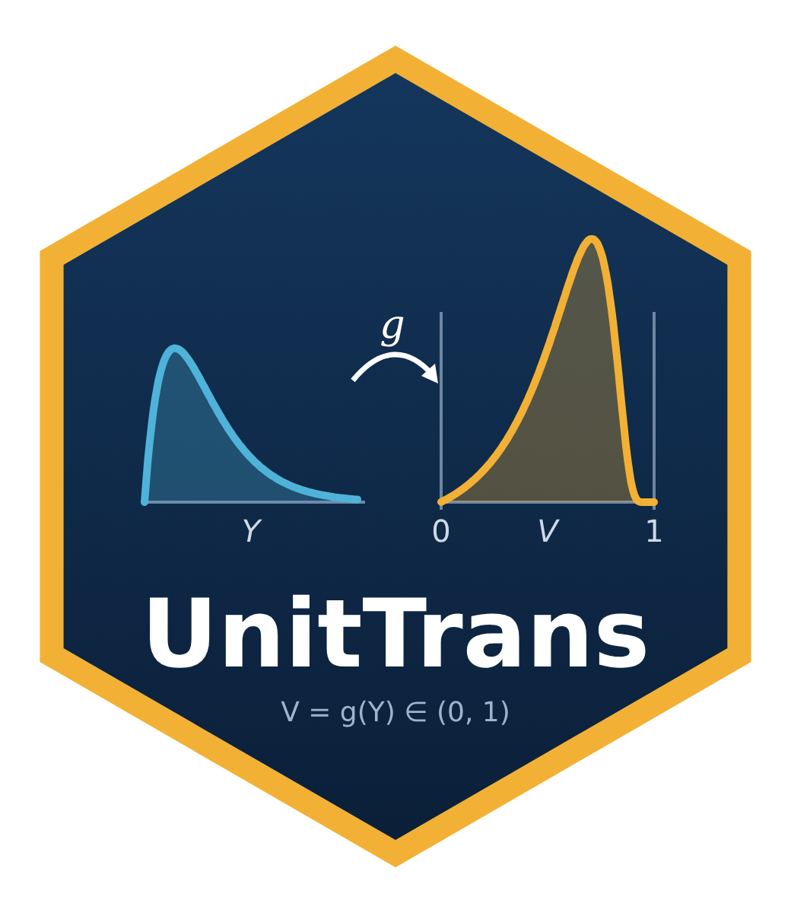

# Statistical Repository

A research-code repository by **Mohamad Yamen Al-Mohamad** (Department of Statistics, University of Tabriz, Tabriz, Iran) and collaborators. It collects the R and Python implementations behind several statistics papers and software packages: new probability distributions, parametric / Bayesian / ANN-based estimation, stress–strength reliability, statistical process control, fuzzy random variables, and distributions on the unit interval.

Each folder is **self-contained** (its own code, and in most cases its own README). This file is the map: what each project is, what it contains, how to run it, and what to know before you do.

---

## Table of contents

1. [Repository map](#1-repository-map)
2. [Projects at a glance](#2-projects-at-a-glance)
3. [Project details](#3-project-details)
   - [3.1 UnitI Python — `unit_transform_dist`](#31-uniti-python--unit_transform_dist-python-package)
   - [3.2 UnitTransformDist — `unitTransformDist`](#32-unittransformdist--unittransformdist-r-package)
   - [3.3 KwLccharts](#33-kwlccharts-r-package)
   - [3.4 LGBootStrapControlChart](#34-lgbootstrapcontrolchart)
   - [3.5 LR-Fuzzy-Quantile](#35-lr-fuzzy-quantile)
   - [3.6 XGD (XGamma family)](#36-xgd-xgamma-distribution-family)
   - [3.7 Bayesian Estimation for Topp-Leone Distribution](#37-bayesian-estimation-for-topp-leone-distribution)
   - [3.8 TPL_GRL_SS_MODEL](#38-tpl_grl_ss_model)
   - [3.9 KME](#39-kme)
   - [3.10 CommonCountModelDistributions](#310-commoncountmodeldistributions)
   - [3.11 Else](#311-else)
   - [3.12 UnitTrans](#312-unittrans-r-package)
4. [Getting started](#4-getting-started)
5. [Requirements](#5-requirements)
6. [Reproducibility notes](#6-reproducibility-notes)
7. [Known issues and caveats](#7-known-issues-and-caveats)
8. [Citing](#8-citing)
9. [Contributing](#9-contributing)
10. [Authors and contact](#10-authors-and-contact)

---

## 1. Repository map

```
Statistical-Repository/
├── README.md
│
├── UnitI Python/                  Python package unit_transform_dist (v0.3.0): distributions on (0,1)
│   ├── src/unit_transform_dist/   core, extras, lmoments, regression, mixture, bayes, censored,
│   │                              diagnostics, model_selection, plot, registry, generate_all, utils
│   ├── tests/                     pytest suite (10 files)
│   ├── docs/                      Sphinx sources (index, tutorial, api, conf)
│   ├── .github/workflows/         CI
│   ├── pyproject.toml  CHANGELOG.md  CONTRIBUTING.md  MANIFEST.in  LICENSE
│
├── UnitTransformDist/             R package unitTransformDist (v0.1.0): same idea, any base distribution
│   ├── R/                         core, contribution, montecarlo, bias_correction, diagnostics,
│   │                              extras, plot, registry, utils
│   ├── tests/testthat/            vignettes/getting-started.Rmd
│   ├── paper/                     JSS and R Journal manuscripts (tex, pdf, bib, cover letter)
│   ├── DESCRIPTION  NAMESPACE  NEWS.md  cran-comments.md  LICENSE(.md)  Unit.png
│
├── KwLccharts/                    R package (v0.1.0): bootstrap percentile control charts, Kumaraswamy–Lindley
│   ├── R/                         distribution.R, lambertW.R, bootcc.R, KwLccharts-package.R
│   ├── man/                       Rd files for every exported function
│   ├── inst/scripts/              simulation + real-data scripts and result CSVs
│   ├── tests/test-all.R
│
├── LGBootStrapControlChart/       R scripts: bootstrap percentile control chart, Lindley-Geometric law
│   ├── LGBootStrapControlChart.R  MontiCarloSimulation.R  example.R  README.md
│
├── LR-Fuzzy-Quantile/             Python: quantile representation of LR random fuzzy numbers
│   ├── lr_fuzzy_simulation.py/.ipynb   lr_fuzzy_inference.py   requirements.txt
│   └── base_paper/                Python re-implementation of Parchami et al. (2024) + figures/
│
├── XGD/                           XGamma-family distributions (Python)
│   ├── EQXGD/                     Exponentiated Quasi X-Gamma: EQXGD.py, ANNE.py (ANN estimator)
│   ├── GXGD/                      Generalized X-Gamma mixture: monte_carlo_simulation.py (PyTorch)
│   └── QXGD/                      Quasi X-Gamma: Pycode.py (MLE + Monte Carlo)
│
├── Bayesian Estimation for Topp-Leone Distribution/
│   └── Bayesian_Loss_Functions.R  16 Bayes estimators (4 losses x 4 priors)
│
├── TPL_GRL_SS_MODEL/              R: stress–strength model, Topp-Leone strength vs Generalized-Rayleigh stress
│   ├── functions.R  Estimation_function.R  Monte_Carlo_simulation.R
│
├── UnitTrans/                     R package UnitTrans (v0.1.0): unit-interval laws via monotone transforms of a baseline
│   ├── R/                         transformations, dpqr, fit, gof, moments, baseline, simulation
│   ├── man/  tests/testthat/  vignettes/workflow.Rmd
│   ├── DESCRIPTION  NAMESPACE  README.md
│
├── KME/                           Python: stress–strength reliability for the KM-Exponential distribution
│   └── PyCode.py
│
├── CommonCountModelDistributions/ placeholder (no code yet)
└── Else/                          exploratory notebooks (DLE1.ipynb, "Dr homai.ipynb")
```

## 2. Projects at a glance

| Folder | Language | Topic | Kind | Maturity |
|---|---|---|---|---|
| `UnitI Python` | Python ≥ 3.9 | Distributions, regression, mixtures, Bayes, censoring on (0,1) via `Y = 1/(1+X)` | Installable package | v0.3.0, 10 test files, CI, Sphinx docs |
| `UnitTransformDist` | R ≥ 4.1 | Same transform, any user-supplied base distribution; corrected profile-likelihood CI | R package + 2 manuscripts | v0.1.0, pre-CRAN, testthat |
| `UnitTrans` | R ≥ 3.5 | Laws on (0,1) from a baseline Y via rational / exponential / logit / arcsech / probit / cloglog transforms; MLE, model search, bootstrap GoF | R package | v0.1.0, testthat, vignette |
| `KwLccharts` | R ≥ 3.6 | Kumaraswamy–Lindley (KwL) distribution and bootstrap percentile control charts | R package | v0.1.0, `R CMD check`-clean per its README |
| `LGBootStrapControlChart` | R | Bootstrap control chart for Lindley-Geometric percentiles | Scripts | Research code |
| `LR-Fuzzy-Quantile` | Python ≥ 3.9 | LR random fuzzy numbers: quantile generator, simulations, inference | Scripts + notebook | Reproducible, seeded |
| `XGD` | Python | XGamma / EQXGD / GXGD / QXGD distributions, MLE, Monte Carlo, ANN estimation | Scripts | Research code |
| `Bayesian Estimation for Topp-Leone Distribution` | R | Bayes estimators under PLF / WLF / ELF / SLELF losses | Functions | Research code |
| `TPL_GRL_SS_MODEL` | R | Stress–strength reliability, multi-stress and cascade models | Functions + simulation | Research code |
| `KME` | Python | Stress–strength reliability for KM-Exponential | Script | Research code |
| `CommonCountModelDistributions` | – | Count-model distributions | Placeholder | Empty |
| `Else` | Jupyter | Exploratory notebooks | Notebooks | Unstructured |

---

## 3. Project details

### 3.1 UnitI Python — `unit_transform_dist` (Python package)

**Idea.** Turn any continuous distribution `X` on `(0, ∞)` into a distribution on `(0, 1)` through the strictly decreasing map `Y = 1/(1+X)`. With base pdf `f_X`, cdf `F_X`, quantile `Q_X`:

```
f_Y(y) = f_X(1/y - 1) / y^2          F_Y(y) = 1 - F_X(1/y - 1)          Q_Y(p) = 1 / (1 + Q_X(1 - p))
```

The core class `UnitTransformDist` subclasses `scipy.stats.rv_continuous`, so `pdf`, `cdf`, `ppf`, `rvs`, `sf`, `isf`, `stats`, … all work.

**Modules (`src/unit_transform_dist/`)**

| Module | What it provides |
|---|---|
| `core.py` | `UnitTransformDist`, `make_unit_transform`, `fit_unit_transform` (MLE) |
| `registry.py`, `generate_all.py` | Registry of 50+ positive-support `scipy.stats` distributions; `get_registry`, `load_all` |
| `extras.py` | AIC/BIC, KS / Cramér–von Mises / Anderson–Darling tests, hazard and cumulative hazard, bootstrap and profile-likelihood confidence intervals, method of moments, `summary`, `UnitTransformExtras` |
| `lmoments.py` | Sample L-moments, L-moment ratios, `fit_lmoments` |
| `regression.py` | `UnitTransformRegression`: beta-regression-style model (log or identity link on the scale) |
| `mixture.py` | `UnitTransformMixture`: finite mixtures fitted by EM; `pdf`, `cdf`, `rvs`, `aic`, `bic` |
| `bayes.py` | `map_estimate`, dependency-free `metropolis_hastings`, `posterior_summary`, `PriorSpec` |
| `censored.py` | `fit_censored`: right / left / interval censoring and truncation windows |
| `diagnostics.py` | Pearson, Cox–Snell and randomised quantile residuals; `cooks_distance` |
| `model_selection.py` | `auto_select_distribution` ranks all candidate bases by AIC / BIC / log-likelihood |
| `plot.py` | `plot_pdf`, `plot_cdf`, `plot_sf`, `plot_all`, `qq_plot`, `pp_plot` |

**Install and run**

```bash
cd "UnitI Python"
pip install -e .            # or: pip install -e ".[dev]"  (pytest, sphinx, build, twine)
pytest                      # runs tests/
```

```python
from unit_transform_dist import make_unit_transform, fit_unit_transform, auto_select_distribution

dist = make_unit_transform("gamma", base_shape_params=(2.5,))
y = dist.rvs(size=500, random_state=42)

fitted = fit_unit_transform(y, "gamma")                       # MLE
ranking = auto_select_distribution(y, criterion="aic", top_n=5)
```

**Tests** (`tests/`): `test_core`, `test_all`, `test_bayes`, `test_bugfixes`, `test_censored`, `test_diagnostics`, `test_lmoments`, `test_mixture`, `test_model_selection`, `test_regression`.
**Docs**: Sphinx sources in `docs/` (`index.rst`, `tutorial.rst`, `api.rst`, `conf.py`). **Typing**: ships `py.typed`.
**History**: see `CHANGELOG.md`. Version 0.3.0 added L-moments, regression, mixtures, Bayes, censoring, diagnostics and model selection, and fixed an invalid profile-likelihood interval (wrong `chdtri` argument order, and nuisance parameters held fixed instead of re-optimised).

---

### 3.2 UnitTransformDist — `unitTransformDist` (R package)

**Idea.** The same odds-inverting transform, but the base distribution is passed **as functions** (`d`, `p`, optional `q`, `r`), so it works with built-in R distributions and with fully custom ones that have no closed-form quantile (the quantile is then obtained by numerically inverting the cdf).

```r
library(unitTransformDist)
d   <- utd(dgamma, pgamma, qgamma, rgamma, params = list(shape = 2.5))
y   <- rutd(500, d)
fit <- fit_utd_mle(y, dgamma, start = c(shape = 1), lower = c(shape = 1e-6))
summary(fit)
profile_likelihood_ci(fit, "shape")       # nuisance parameters re-optimised at each grid point
```

**Key contribution.** A profile-likelihood interval must re-optimise the nuisance parameters at every candidate value. Freezing them gives intervals with no coverage guarantee. In the package's own Monte Carlo check (gamma shape, n = 60, 150 replications) the naive version covered about **59 %** at the nominal 95 %, the corrected one about **94 %**. `compare_profile_likelihood_coverage()` lets you reproduce this, and a testthat test guards it.

**Source files (`R/`)**

| File | Contents |
|---|---|
| `core.R` | `utd`, `dutd`/`putd`/`qutd`/`rutd`, `fit_utd_mle`, `profile_likelihood_ci`; S3 methods `print`, `summary`, `coef`, `logLik`, `vcov` |
| `contribution.R` | `safe_profile_likelihood`, `compare_profile_likelihood_coverage`, `bias_correct_analytic` (**experimental**) |
| `montecarlo.R` | `run_monte_carlo`, `compare_estimators_mc`, `mc_sample_size_study` |
| `bias_correction.R` | jackknife, bootstrap, median-unbiased, Firth-type, double bootstrap; `bias_correct()` |
| `diagnostics.R` | Pearson, quantile and Cox–Snell residuals, Cook's distance |
| `extras.R` | `AIC`, `BIC`, `wald_ci`, `bootstrap_ci`, `ks_test`, `hazard` |
| `plot.R` | `plot_pdf`, `plot_cdf`, `qq_plot` (base R; ggplot2 optional) |
| `registry.R` | optional name registry (`utd_register`, `utd_get`, …) |

**Also included**: `vignettes/getting-started.Rmd` (with an XGamma case study), `tests/testthat/`, `paper/` (a *Journal of Statistical Software* manuscript and an *R Journal* manuscript with `.tex`, `.pdf`, `.bib`, cover letter), `NEWS.md`, `cran-comments.md`.

**Install**

```r
install.packages("UnitTransformDist", repos = NULL, type = "source")   # from a local copy of this folder
devtools::test()                                                       # run the tests
```

Only base R (`stats`, `graphics`) is required; `ggplot2`, `knitr`, `rmarkdown`, `testthat` are suggested.

---

### 3.3 KwLccharts (R package)

**Parametric bootstrap percentile control charts for the Kumaraswamy–Lindley (KwL) distribution**, the three-parameter law obtained from the Kumaraswamy-G construction on a Lindley baseline. Companion to the manuscript *"A Parametric Bootstrap Control Chart for Kumaraswamy–Lindley Percentiles"*; the method adapts the Lindley-Geometric chart of Al-Lami, Jabbari Khamnei and Heydari (2025, doi:10.1371/journal.pone.0316449).

| Function | Purpose |
|---|---|
| `dKwL`, `pKwL`, `qKwL`, `rKwL` | density, cdf, closed-form quantile (via Lambert W), random generation |
| `gLindley`, `GLindley`, `QLindley` | Lindley baseline density, cdf, quantile |
| `lambertW0`, `lambertWm1` | self-contained Lambert W, both real branches (no external dependency) |
| `negloglik_KwL`, `fit_KwL` | negative log-likelihood and multi-start L-BFGS-B maximum likelihood for (θ, a, b) |
| `KwLBootCC` | Phase-I bootstrap control limits for a chosen percentile `u` |
| `KwL_ARL` | Phase-II average-run-length simulation (in control or shifted) |

```r
install.packages("KwLccharts_0.1.0.tar.gz", repos = NULL, type = "source")   # after R CMD build KwLccharts
library(KwLccharts); set.seed(1)
lim <- KwLBootCC(u = 0.05, alpha = 0.0027, theta = 1, a = 1.5, b = 1.5, n = 5, B = 300, MC = 10)
KwL_ARL(u = 0.05, LCL = lim$MLCL, UCL = lim$MUCL,
        theta1 = 1, a1 = 1.5, b1 = 1.5, n_runs = 20, max_run = 700)
```

**Reproducing the manuscript** — `inst/scripts/`: `run_simulation.R`, `run_one_limit.R`, `run_one_arl.R`, `real_data_example.R` (gastric-cancer survival data of Bekker, Roux & Mosteit, 2000) and the result tables `limits_table.csv`, `arl_table.csv`, `real_data_limits.csv`, `real_data_subgroups.csv`. Manuscript settings are modest (B = 300, MC = 10, 20 Phase-II runs per ARL entry); raise `B`, `MC`, `n_runs` for production precision.

**Validation** (`tests/test-all.R`): the KwL density integrates to 1; `qKwL` inverts `pKwL` to within 1e-6; `fit_KwL` recovers parameters as n grows (checked at 1,000 / 5,000 / 20,000). License: MIT.

---

### 3.4 LGBootStrapControlChart

Bootstrap percentile control chart for the **Lindley-Geometric (LG)** distribution (parameters `theta`, `p`) — the method that `KwLccharts` generalises.

| File | Role |
|---|---|
| `LGBootStrapControlChart.R` | `LGBootStrapControlChart()`; also `fit_distribution()` (MLE with `fitdistrplus`) |
| `MontiCarloSimulation.R` | loops over grids of `n`, `u`, `p`, `theta`, calls the function, writes `res.csv` |
| `example.R` | minimal example |

**How it works.** For each Monte Carlo repetition: draw bootstrap samples, refit `(theta, p)`, compute the `u`-quantile of each fit, and take the empirical `alpha/2` and `1-alpha/2` quantiles as LCL/UCL. The mean of these over repetitions gives `MLCL`/`MUCL`. Average run length is then simulated by drawing new samples until the estimated quantile leaves the limits.

**Arguments**: `u` (quantile), `alpha` (Type-I error), `theta`, `p`, `n` (default 5), `BootStrap_iterations`, `MontiCarlo_iter`, `ARL_rep`, `verbos`.
**Returns**: list with `MLCL`, `MUCL`, `SDLCL`, `SDUCL`, `MARL`, `SDARL`.

```r
source("LGBootStrapControlChart.R")
res <- LGBootStrapControlChart(u = 0.99, alpha = 0.07, theta = 2, p = 0.8, n = 5,
                               BootStrap_iterations = 1e4, MontiCarlo_iter = 20,
                               ARL_rep = 1000, verbos = TRUE)
```

Requires `LindleyPowerSeries` and `fitdistrplus` (installed automatically if missing). Cite: Prof. Dr. Ali Akbar Heydari, University of Tabriz.

---

### 3.5 LR-Fuzzy-Quantile

Code for the article **"Quantile representation of LR random fuzzy numbers"** (Al-Mohamad, Parchami, Hydari), a contribution to Parchami, Grzegorzewski & Romaniuk (2024), *Statistical simulations with LR random fuzzy numbers*, Statistical Papers 65, 3585–3609.

**Contribution.** For spread laws with continuous strictly increasing cdfs `F_l, F_r` and quantiles `Q_l, Q_r`, the LR random fuzzy number has the exact α-cut form

```
X_alpha = [ C - Q_l((1-alpha) V_l) ,  C + Q_r((1-alpha) V_r) ],     V_j = F_j(S^j) ~ U(0,1)
```

with `(C, V_l, V_r)` independent. Consequences simulated here: a faster generator (Algorithm 2′: three uniforms and two quantile evaluations), the Aumann expectation in closed form, a non-asymptotic convergence bound for the k-knot polygons, dependence through a Gaussian copula, and exact recovery of the spread law with a Kolmogorov-type goodness-of-fit test and Fisher information of the knots.

| File | Role |
|---|---|
| `lr_fuzzy_simulation.py` | main study → one Excel sheet per experiment (`Config`, `Equivalence`, `Convergence`, `Aumann`, `Dependence`, `Timing`, `Fuzzy_sample_*`, `Fuzzy_interval_*`) |
| `lr_fuzzy_simulation.ipynb` | the same study for Google Colab (badge in the folder README) |
| `lr_fuzzy_inference.py` | inference experiments (`recover`, `compat`, `gof`, `mle`) → `inference_results.json` |
| `base_paper/parchami2024_base_paper.py` | independent implementation of Algorithms 1–3 and Examples 1–3 of the base paper; figures in `base_paper/figures/` |
| `requirements.txt` | numpy, scipy, pandas, openpyxl |

```bash
cd LR-Fuzzy-Quantile
pip install -r requirements.txt
python lr_fuzzy_simulation.py --quick                # fast test
python lr_fuzzy_simulation.py --reps 2000 --seed 7 --out my_results.xlsx
python lr_fuzzy_inference.py --only gof --out gof.json
cd base_paper && python parchami2024_base_paper.py --example all --outdir figures
```

Default seeds: 2026 (simulation, inference) and 2024 (base-paper figures). Scenarios A/B/C (core N(0,1) with Exp/Beta, χ², or Gamma/Uniform spreads) are edited at the top of the script. See the folder README for the full table of results and troubleshooting.

---

### 3.6 XGD (XGamma distribution family)

The **XGamma distribution** (Sen, Maiti & Chandra, 2016) is a two-component mixture of an Exponential(θ) and a Gamma(3, θ) law with weights θ/(1+θ) and 1/(1+θ). The sub-folders implement three extensions, all with MLE and Monte Carlo studies.

| Sub-folder | Distribution | Files | Highlights |
|---|---|---|---|
| `EQXGD/` | Exponentiated Quasi X-Gamma, parameters `(theta, alpha, beta)` | `EQXGD.py`, `ANNE.py`, `Readme.md` | `pEQXGD`, `dEQXGD`, `rEQXGD`, `neg_log_likelihood`, `monte_carlo_simulation`, `fitAndPlot` (histogram, fitted density, log-likelihood, AIC, BIC). `ANNE.py` trains a Keras network (128-64-32-3) to predict `(theta, alpha, beta)` directly from sorted samples |
| `GXGD/` | Generalized X-Gamma: exponential–gamma mixture, parameters `(theta, a, b, w)` | `Readme.md`, `monte_carlo_simulation.py` | pdf `w/(1+w)·θe^{-θx} + 1/(1+w)·b^a/Γ(a)·x^{a-1}e^{-bx}`; limits to gamma as `w→0` and exponential as `w→∞`; PyTorch/Adam MLE with gradient clipping, `monte_carlo_simulation` |
| `QXGD/` | Quasi X-Gamma, parameters `(alpha, theta)` | `Pycode.py`, `README.md`, `init` | `dQXGD`, `pQXGD`, `rQXGD` (inverse transform), MLE via `scipy.optimize.minimize`, Monte Carlo bias and MSE (n = 20, α = θ = 0.5, 10,000 runs in the documented setup) |

```bash
pip install numpy scipy matplotlib               # EQXGD, QXGD
pip install torch tqdm                           # GXGD
pip install tensorflow scikit-learn              # ANNE.py
python XGD/QXGD/Pycode.py
python XGD/GXGD/monte_carlo_simulation.py        # runs a 1,000-replication study on import
```

---

### 3.7 Bayesian Estimation for Topp-Leone Distribution

R functions for Bayes estimators of the Topp-Leone shape parameter from **trimmed (r-th order-statistic-based) samples**, following Sindhu, Saleem & Aslam (2013), *Bayesian estimation for Topp Leone distribution under trimmed samples*, J. Basic Appl. Sci. Res. 3(10), 347–360.

|  | Uniform | Jeffreys | Exponential(`w`) | Gamma(`a`, `b`) |
|---|---|---|---|---|
| **PLF** (pointwise logarithmic) | `PLF_loss_uniform` | `PLF_loss_Jeffreys` | `PLF_loss_exponential` | `PLF_loss_gamma` |
| **WLF** (weighted) | `WLF_uniform` | `WLF_Jeffreys` | `WLF_exponential` | `WLF_gamma` |
| **ELF** (entropy) | `ELF_uniform` | `ELF_Jeffreys` | `ELF_exponential` | `ELF_gamma` |
| **SLELF** (squared-log error) | `SLELF_uniform` | `SLELF_Jeffreys` | `SLELF_exponential` | `SLELF_gamma` |

All take the observations `x` (values in (0,1)), `r`, `k`, plus `w` or `a, b` where the prior needs them. The helper `xi(x, r, k)` computes the sufficient statistic.

```r
source("Bayesian_Loss_Functions.R")      # needs gtools, gsl, VGAM (installed if missing)
x <- c(0.12, 0.25, 0.31, 0.44, 0.58)     # example data in (0,1)
PLF_loss_uniform(x, r = 3, k = 2)
SLELF_gamma(x, r = 3, k = 2, a = 1, b = 0.5)
```

---

### 3.8 TPL_GRL_SS_MODEL

Stress–strength reliability where **strength `X ~ Topp-Leone(v)`** (TPL) and **stress `Y ~ Generalized Rayleigh(alpha, beta)`** (GRL).

| File | Contents |
|---|---|
| `functions.R` | `R()` — reliability `R = ∫₀¹ (1 − F_X(x)) · g_Y(c·x) dx` by numerical integration; `Multi_Stress_Environments()` (product over k stress environments); `R3()` (three-variable model `(1 − R(θ₂,θ₃))·R(θ₁,θ₃)`); `Ri_casecade()` / `casecade()` (cascade system with scaling constant `c`) |
| `Estimation_function.R` | `TplMle`, `GrlMle` (MLE through `VGAM::vglm`); `TplJack`, `GrlJack` (leave-one-out jackknife); `TPL_Baysian`, `GRL_Baysian` (Metropolis sampler via `MCMCpack::MCMCmetrop1R`, Gamma priors) |
| `Monte_Carlo_simulation.R` | `MC = 1000` replications over `n ∈ {10, 25, 50}`, `v ∈ {0.3, 0.5, 0.7, 0.9}` and six `(alpha, beta)` pairs; estimates every method on each draw and writes `combined_matrix.csv` |

```r
source("functions.R"); source("Estimation_function.R")
R(theta1 = 0.7, theta2 = c(1, 1))
Multi_Stress_Environments(2, 0.1, matrix(c(0.1, 0.1, 0.2, 0.2), 2, 2))
source("Monte_Carlo_simulation.R")        # long-running; writes combined_matrix.csv
```

Packages used by the code: `VGAM`, `MCMCpack`, and an `integral()` routine (e.g. from `pracma`).

---

### 3.9 KME

Python implementation of **stress–strength reliability `R = P(Y < X)` for the KM-Exponential (KME) distribution**, reproducing the approach of Kavya & Manoharan (2023) (distribution: Kavya & Manoharan, 2021).

- `KMExponential(lambda)` — `pdf`, `cdf` (`e/(e−1)·[1 − exp(−(1 − e^{−λx}))]`), `survival`, inverse-transform `generate_samples`.
- `StressStrengthKME` — `calculate_R` (series expansion with truncation controls `m_terms`, `n_terms`, `i_terms`), `mle_lambda`, `estimate_R_mle`, `asymptotic_variance_R`, `confidence_interval`.
- `simulation_study`, `print_simulation_results`, `plot_simulation_results`, and `analyze_example_data` (the two 20-observation data sets of the paper).

```bash
pip install numpy scipy matplotlib
python KME/PyCode.py       # parameter table, simulation study (500 runs x 6 sample-size pairs), real-data example
```

---

### 3.10 CommonCountModelDistributions

Placeholder folder (a single `init` file). Reserved for count-model distributions; no code yet.

### 3.11 Else

Two exploratory Jupyter notebooks, `DLE1.ipynb` and `Dr homai.ipynb` (large files with stored outputs). They are not documented and are not part of any package.

### 3.12 UnitTrans (R package)



Builds new distributions on (0,1) by applying a monotone transformation `V = g(Y)` (rational, exponential, logit, arcsecant-hyperbolic, probit, complementary log-log) to a baseline random variable `Y` with any available `d/p/q/r` functions.

- `dtrans`, `ptrans`, `qtrans`, `rtrans` — density, CDF, quantile, random generation
- `fit_trans`, `fit_all`, `best_model` — maximum likelihood and automatic search over baseline/transformation pairs
- `gof_trans` — goodness-of-fit with parametric bootstrap
- `moments_trans`, `survival_trans`, `hazard_trans`, `simulation_study`

```r
remotes::install_github("yamenetoo/Statistical-Repository", subdir = "UnitTrans", build_vignettes = TRUE)
```

See [`UnitTrans/README.md`](UnitTrans/README.md) and the `workflow` vignette.

---

## 4. Getting started

```bash
git clone https://github.com/yamenetoo/Statistical-Repository.git
cd Statistical-Repository
```

Pick a project from the table in section 2, `cd` into it and follow its section above. A typical session:

| I want to … | Go to |
|---|---|
| model proportions or any (0,1) data, in Python | `UnitI Python` → `pip install -e .` |
| do the same in R with my own base distribution | `UnitTransformDist` |
| build a control chart for percentiles | `KwLccharts` (3-parameter) or `LGBootStrapControlChart` |
| simulate or analyse LR fuzzy numbers | `LR-Fuzzy-Quantile` |
| fit XGamma-type distributions | `XGD/<variant>` |
| estimate stress–strength reliability | `TPL_GRL_SS_MODEL` (R) or `KME` (Python) |
| compute Bayes estimators for Topp-Leone | `Bayesian Estimation for Topp-Leone Distribution` |

## 5. Requirements

| Stack | Needed by | Packages |
|---|---|---|
| Python ≥ 3.9 | `UnitI Python`, `LR-Fuzzy-Quantile`, `XGD`, `KME` | numpy, scipy, matplotlib; pandas + openpyxl (LR-Fuzzy); torch + tqdm (GXGD); tensorflow + scikit-learn (ANNE); pytest, sphinx (dev) |
| R ≥ 3.6 (≥ 4.1 for `UnitTransformDist`) | `KwLccharts`, `UnitTransformDist`, `LGBootStrapControlChart`, `Bayesian Estimation…`, `TPL_GRL_SS_MODEL` | `stats`; `LindleyPowerSeries`, `fitdistrplus` (LG chart); `gtools`, `gsl`, `VGAM` (Bayesian losses); `VGAM`, `MCMCpack`, an `integral()` provider (TPL-GRL); `testthat`, `knitr`, `rmarkdown`, `ggplot2` (optional) |

## 6. Reproducibility notes

- Seeds are fixed in `LR-Fuzzy-Quantile` (2026 / 2024) and shown in the `KwLccharts` examples; the other simulation scripts do not set seeds, so add `set.seed()` / `np.random.seed()` before running them if you need identical numbers.
- Several simulations are heavy: bootstrap + MLE refitting (`KwLccharts`, `LGBootStrapControlChart`), 1,000-replication Monte Carlo with jackknife and MCMC (`TPL_GRL_SS_MODEL`), 1,000 PyTorch fits (`GXGD`). Start with reduced settings.
- Reported timings in `LR-Fuzzy-Quantile` were obtained on a 2-vCPU Colab-class machine; only the ratios between algorithms are meaningful across hardware.

## 7. Known issues and caveats

Collected here so that nobody is surprised; none of these have been changed by this README.

- **`Bayesian_Loss_Functions.R`**: the example block at the bottom uses a variable `x` that is never defined, so `source()` stops with an error after the function definitions have loaded. Define `x` first (or delete the block). `WLF_Jeffreys` and `ELF_Jeffreys` call `gamma(r - 1)`, so they need `r > 1`; `WLF_gamma` and `ELF_gamma` need `a + r > 1`.
- **`LGBootStrapControlChart.R`**: `MARL` and `SDARL` are only computed inside `if (verbos)`, so calling with `verbos = FALSE` fails at `return()`. Use `verbos = TRUE` until this is fixed. The folder README lists the argument as `ARL_repetition`, while the code uses `ARL_rep`.
- **`KwLccharts`**: `DESCRIPTION` still carries a placeholder maintainer e-mail (`yamen@example.edu`), and the README mentions a `scripts/` directory that actually lives in `inst/scripts/`.
- **`UnitI Python/LICENSE`** is an empty file although the package declares the MIT license; `UnitTransformDist` has proper license files. The README of `UnitTransformDist` has ORCID placeholders for two authors and DOI/volume placeholders in the citation entries.
- **`UnitTransformDist`**: `bias_correct_analytic()` is experimental and unverified; no parallelisation; not yet on CRAN.
- **`XGD`**: the folder README (`XGD/README.md`) still has template placeholders (`[..]` license, empty acknowledgements) and an incorrect remark linking XGamma to the GEV family; the correct description is the exponential–gamma mixture above. `ANNE.py` and `GXGD/monte_carlo_simulation.py` run work at import time (no `if __name__ == "__main__"` guard), and `ANNE.py` depends on `EQXGD.py` functions (`rEQXGD`) being in scope. Its output layer uses ReLU, which can output zeros for parameters that must be positive.
- **`KME/PyCode.py`**: the asymptotic variance of `R` uses a simplified Fisher information (`n/λ²`); the code comments flag this as an approximation of the paper's expression.
- **`TPL_GRL_SS_MODEL`**: the folder README is titled "SS", spells the distribution "Topplie", and refers to `Estimation_functions.R` (the file is `Estimation_function.R`). It also has an empty `init` file.
- **`Else/`** and **`CommonCountModelDistributions/`** are not documented / empty respectively.

## 8. Citing

If you use code from this repository, cite the corresponding paper or package.

```
Al-Mohamad, M. Y., Parchami, A., Hydari, A. A.  Quantile representation of LR random fuzzy numbers. Manuscript.
Al-Mohamad, M. Y., Heydari, A. A., Jabbari Khamnei, H.  A Parametric Bootstrap Control Chart for Kumaraswamy–Lindley Percentiles. Manuscript.
Al-Mohamad, M. Y., Heydari, A. A., Jabbari Khamnei, H. (2026). unitTransformDist: Generalized (0,1)-Interval Distributions from Any Base Distribution on (0, ∞). R package version 0.1.0.
Al-Mohamad, M. Y., Heydari, A. A., Jabbari Khamnei, H. (2026). unit_transform_dist: Probability distributions on (0,1) via the unit transform. Python package version 0.3.0.
```

Original works that the code reproduces or extends:

- Parchami, A., Grzegorzewski, P., Romaniuk, M. (2024). Statistical simulations with LR random fuzzy numbers. *Statistical Papers* 65, 3585–3609.
- Sindhu, T. N., Saleem, M., Aslam, M. (2013). Bayesian estimation for Topp Leone distribution under trimmed samples. *J. Basic Appl. Sci. Res.* 3(10), 347–360.
- Al-Lami, Jabbari Khamnei, Heydari (2025). Bootstrap control chart for the Lindley-Geometric distribution. doi:10.1371/journal.pone.0316449.
- Cordeiro, G. M., de Castro, M. (2011). A new family of generalized distributions (Kumaraswamy-G). *J. Stat. Comput. Simul.*
- Kavya, P., Manoharan, M. (2021, 2023). KM-Exponential distribution and its stress–strength reliability.
- Sen, S., Maiti, S. S., Chandra, N. (2016). The XGamma distribution. *J. Mod. Appl. Stat. Methods.*

## 9. Contributing

Issues and pull requests are welcome. Please:

1. open an issue describing the problem or idea first;
2. include a minimal reproducible example (data, seed, package versions);
3. add or update a test when touching a package (`pytest` for `UnitI Python`, `testthat` for the R packages);
4. keep each project self-contained: new code goes in its own folder with its own README.

## 10. Authors and contact

**Mohamad Yamen Al-Mohamad** — maintainer
Department of Statistics, Faculty of Mathematics, Statistics and Computer Science, University of Tabriz, Tabriz, Iran
yamenmohamad@tabrizu.ac.ir · ORCID [0009-0009-1665-7203](https://orcid.org/0009-0009-1665-7203) · GitHub [@yamenetoo](https://github.com/yamenetoo)

Co-authors on the various projects: **Ali Akbar Heydari** (heydari@tabrizu.ac.ir), **Hossein Jabbari Khamnei** (h_jabbari@tabrizu.ac.ir), Department of Statistics, University of Tabriz; **Abbas Parchami** (Shahid Bahonar University of Kerman) for the LR-fuzzy work.

Each sub-project declares its own license (MIT for `KwLccharts`, `UnitTransformDist` and `UnitI Python`); check the folder before reuse.
