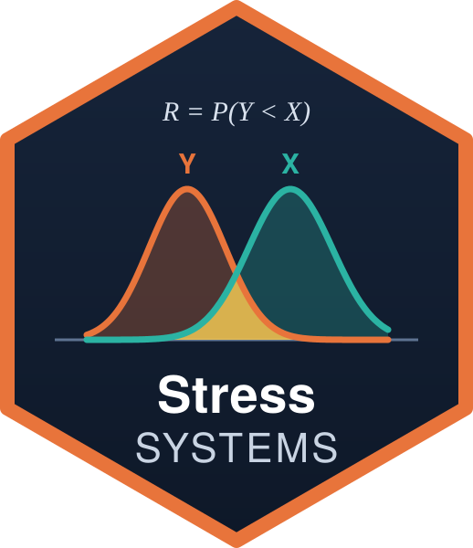

# StressSystems 

**Stress-strength reliability for any pair of continuous distributions — single components and multicomponent systems, with estimation, confidence intervals and Monte Carlo studies.**

[](https://colab.research.google.com/github/yamenetoo/Statistical-Repository/blob/main/StressSystems/notebooks/StressSystems_examples.ipynb)


---

## Contents

1. [Overview](#overview)
2. [Installation](#installation)
3. [Quick start](#quick-start)
4. [Distributions](#distributions)
5. [Reliability measures](#reliability-measures)
6. [Parameter estimation](#parameter-estimation)
7. [Estimating R and confidence intervals](#estimating-r-and-confidence-intervals)
8. [Monte Carlo studies](#monte-carlo-studies)
9. [Numerical details](#numerical-details)
10. [Function reference](#function-reference)
11. [Examples notebook](#examples-notebook)
12. [Testing](#testing)
13. [Citation](#citation)
14. [Authors and license](#authors-and-license)

---

## Overview

In the stress-strength model a component with random strength $X$ works as
long as it exceeds the random stress $Y$ applied to it. Its reliability is

$$R = P(Y < X) = \int F_Y(x)\, f_X(x)\, dx .$$

Most software for this model is written for one specific pair of
distributions. **StressSystems** works with **any** two continuous
distributions given by a density and a distribution function, and goes beyond
the single-component case:

| Feature | Covered |
|---|---|
| Any pair of distributions (by name or user-defined) | ✓ |
| Stress scaling factor $c$ (amplified or attenuated stress) | ✓ |
| Multi-stress environments (shared or independent components) | ✓ |
| Three-variable model $P(Z < Y < X)$ | ✓ |
| $s$-out-of-$k$ systems | ✓ |
| Cascade (standby) systems | ✓ |
| MLE, MPS, LSE, WLSE, Cramér–von Mises, Anderson–Darling | ✓ |
| Jackknife and bootstrap bias-corrected estimators | ✓ |
| Bayesian estimation (adaptive Metropolis–Hastings) | ✓ |
| Delta-method, bootstrap and posterior intervals for $R$ | ✓ |
| Ready Monte Carlo engine (bias, MSE, coverage, interval length) | ✓ |

The CRAN package `StressCensoR` also accepts user-supplied distributions and
focuses on censored samples for the single-component model.
`StressSystems` complements it with multicomponent systems, resampling
estimators, interval estimation for $R$ and simulation tools.

---

## Installation

```r
# install.packages("remotes")
remotes::install_github("yamenetoo/Statistical-Repository", subdir = "StressSystems")
library(StressSystems)
```

The package depends only on base R (`stats`, `utils`, `parallel`).
`testthat` is needed only to run the tests.

---

## Quick start

```r
library(StressSystems)

X <- ss_dist("toppleone")       # strength: Topp-Leone
Y <- ss_dist("genrayleigh")     # stress: generalized Rayleigh

# True reliability
ss_R(X, Y, par_x = c(shape = 0.7), par_y = c(shape = 1, rate = 2))

# Estimate it from data
set.seed(1)
x <- rtoppleone(30, shape = 0.7)
y <- rgenrayleigh(30, shape = 1, rate = 2)
ss_estimate_R(x, y, X, Y, method = "mle")     # estimate + 95% delta-method CI
```

---

## Distributions

All work goes through a distribution object created by `ss_dist()`.

### Built-in families

| Name | Support | Parameters | CDF |
|---|---|---|---|
| `"toppleone"` | $(0,1)$ | `shape` $\nu>0$ | $F(x)=[x(2-x)]^{\nu}$ |
| `"genrayleigh"` | $(0,\infty)$ | `shape` $\alpha>0$, `rate` $\lambda>0$ | $F(x)=\left(1-e^{-(\lambda x)^2}\right)^{\alpha}$ |

Each comes with `d`, `p`, `q` and `r` functions: `dtoppleone()`,
`ptoppleone()`, `qtoppleone()`, `rtoppleone()`, `dgenrayleigh()`, …

> **Parametrisation note.** `genrayleigh` uses a *rate* $\lambda$.
> `VGAM::dgenray()` uses `scale` $=1/\lambda$.

### Any R family by name

If the functions `d<name>`, `p<name>` (and optionally `q<name>`, `r<name>`)
exist, the family can be used by name. The parameter names are read from the
arguments of the density:

```r
W <- ss_dist("weibull", par = c(shape = 2, scale = 1.5))
G <- ss_dist("gamma")           # shape, rate  (the redundant 'scale' is dropped)
N <- ss_dist("norm")            # mean (real), sd (positive)
```

This includes families from other packages once they are loaded, e.g.
`ss_dist("genray")` after `library(VGAM)`.

### User-defined families

Only a density and a distribution function are required. Missing quantile and
random-number functions are obtained by numerical inversion of the CDF.

```r
dlindley <- function(x, theta, log = FALSE) {
  d <- ifelse(x > 0, theta^2 / (1 + theta) * (1 + x) * exp(-theta * x), 0)
  if (log) log(d) else d
}
plindley <- function(q, theta)
  ifelse(q > 0, 1 - (1 + theta + theta * q) / (1 + theta) * exp(-theta * q), 0)

L <- ss_dist(d = dlindley, p = plindley, lower = 0, upper = Inf,
             constraints = list(theta = "positive"))
```

### Parameter constraints and support

Each parameter has a range used by the estimators:

| Constraint | Range | Internal transformation |
|---|---|---|
| `"positive"` | $(0,\infty)$ | $\log$ |
| `"unit"` | $(0,1)$ | logit |
| `"real"` | $(-\infty,\infty)$ | none |
| `c(a, b)` | $(a,b)$ | scaled logit |

When not given, location-type names (`mean`, `mu`, `location`, …) are taken
as real and all others as positive. The support is guessed from the density
when `lower`/`upper` are not supplied; a message reports the guess. **Give the
support explicitly for bounded supports other than $(0,1)$.**

---

## Reliability measures

All functions accept parameters either stored in the distribution objects
(`ss_dist(par = ...)`) or passed explicitly.

### Single component — `ss_R()`

$$R(c) = P(cY < X) = E_X\!\left[F_Y(X/c)\right], \qquad c > 0 .$$

`c = 1` gives the classical $P(Y<X)$; `c > 1` amplifies and `c < 1`
attenuates the stress.

```r
ss_R(X, Y, c(shape = 0.7), c(shape = 1, rate = 2), c = 1.5)
```

### Multi-stress environment — `ss_multistress()`

A component faces $k$ independent stresses $Y_1,\dots,Y_k$.

- `components = "shared"` (default) — the same component must withstand all
  of them:
  $R = P(cY_j < X \ \forall j) = E_X\big[\prod_j F_{Y_j}(X/c)\big]$.
- `components = "independent"` — each stress acts on its own independent
  copy: $R = \prod_j P(cY_j < X_j)$.

```r
ss_multistress(X, Y, par_x = c(shape = 0.7),
               par_y = data.frame(shape = c(1, 2), rate = c(2, 3)))
```

### Three-variable model — `ss_R3()`

$$R_3 = P(Z < Y < X) = E_Y\!\left[F_Z(Y)\,\{1 - F_X(Y)\}\right].$$

This is **not** $P(Y<X)\,P(Z<Y)$: both events involve the same $Y$.

```r
ss_R3(lower = X, stress = Y, upper = X,
      par_z = c(shape = 0.3), par_y = c(shape = 1, rate = 2), par_x = c(shape = 0.9))
```

### $s$-out-of-$k$ system — `ss_sk()`

$k$ independent components with common strength distribution, common stress
$cY$; the system works if at least $s$ components survive:

$$R_{s,k} = \sum_{i=s}^{k}\binom{k}{i}\, E_Y\!\left[\{1-F_X(cY)\}^{i}\,F_X(cY)^{k-i}\right].$$

```r
ss_sk(X, Y, s = 2, k = 3, par_x = c(shape = 0.7), par_y = c(shape = 1, rate = 2))
```

### Cascade system — `ss_cascade()`

$n$ stages; when stage $i-1$ fails, stage $i$ takes over with stress scaled by
$c^{i-1}$. With $P_i = P(c^{i-1}Y_i < X_i)$ and independent stages,

$$R = \sum_{i=1}^{n} P_i \prod_{j<i} (1-P_j).$$

Distributions and parameters may be the same at every stage or differ per
stage (lists, or one row per stage).

```r
ss_cascade(X, Y, n = 3, c = 0.8, par_x = c(shape = 0.7), par_y = c(shape = 1, rate = 2))
```

---

## Parameter estimation

`ss_fit(x, dist, method)` estimates the parameters of any `ss_dist`.
No starting values are needed: optimisation runs on the unconstrained scale
from a set of screened random starting points (Nelder–Mead followed by BFGS,
or Brent for one parameter).

With order statistics $x_{(1)}\le\dots\le x_{(n)}$ and $F_i = F(x_{(i)};\theta)$:

| `method` | Estimator | Criterion |
|---|---|---|
| `"mle"` | Maximum likelihood | $\max \sum \log f(x_i;\theta)$ (also returns the covariance matrix) |
| `"mps"` | Maximum product of spacings | $\max \sum_{i=1}^{n+1}\log(F_i - F_{i-1})$ |
| `"lse"` | Least squares | $\min \sum \big(F_i - \tfrac{i}{n+1}\big)^2$ |
| `"wlse"` | Weighted least squares | weights $\tfrac{(n+1)^2(n+2)}{i(n-i+1)}$ |
| `"cvm"` | Cramér–von Mises | $\min \tfrac{1}{12n} + \sum \big(F_i - \tfrac{2i-1}{2n}\big)^2$ |
| `"ad"` | Anderson–Darling | $\min -n - \tfrac1n\sum (2i-1)\big[\log F_i + \log(1-F_{n+1-i})\big]$ |
| `"jackknife"` | Jackknife bias correction | $n\hat\theta - (n-1)\bar\theta_{(\cdot)}$ |
| `"bootstrap"` | Bootstrap bias correction | $2\hat\theta - \bar\theta^{*}$ |
| `"bayes"` | Posterior mean | adaptive random-walk Metropolis–Hastings |

```r
ss_fit(y, Y, method = "mps")
ss_fit(x, X, method = "jackknife", base = "mle")      # base: the point method used inside
ss_fit(x, X, method = "bootstrap", B = 500, type = "parametric")
```

### Bayesian estimation

`ss_bayes()` samples on the unconstrained scale, starts from the MLE, uses
the inverse observed information as proposal covariance and tunes its scale
during burn-in. The Jacobian is included, so the prior is on the natural
parameter scale. The prior is any function returning a log density; the
default is flat.

```r
fb <- ss_bayes(y, Y,
               prior = function(th) sum(dgamma(th, shape = 1, rate = 1, log = TRUE)),
               iter = 10000, burnin = 2000, thin = 1)
fb$estimate      # posterior mean
fb$median        # posterior median
fb$draws         # posterior draws
fb$acceptance    # acceptance rate
```

---

## Estimating R and confidence intervals

`ss_estimate_R(x, y, strength, stress, method, ci)` fits both samples and
returns the estimate of $R$ (plug-in, or posterior mean of $R$ for Bayes).

| `ci` | Interval |
|---|---|
| `"delta"` | Delta method from the observed information, on the logit scale (stays in $(0,1)$). Needs `method = "mle"`. |
| `"boot"` | Parametric bootstrap percentile interval. |
| `"bayes"` | Equal-tail posterior interval; the HPD interval is returned in `$hpd`. Needs `method = "bayes"`. |
| `"auto"` | `delta` for MLE, `bayes` for Bayes, none otherwise. |

```r
ss_estimate_R(x, y, X, Y, method = "mle")                      # delta
ss_estimate_R(x, y, X, Y, method = "mps", ci = "boot", B = 500)
ss_estimate_R(x, y, X, Y, method = "bayes", iter = 5000)
ss_estimate_R(x, y, X, Y, method = "mle", c = 1.5)             # P(1.5 Y < X)
```

---

## Monte Carlo studies

### One scenario — `ss_simulate()`

```r
sim <- ss_simulate(X, Y,
                   par_x = c(shape = 0.7), par_y = c(shape = 1, rate = 2),
                   n = c(10, 25, 50), MC = 1000,
                   methods = c("mle", "mps", "jackknife", "bayes"),
                   seed = 2026, cores = 4)
sim$summary
sim$parameters
```

- `n` is a vector (equal sample sizes) or a two-column matrix of
  `(n_x, n_y)` pairs.
- `cores > 1` runs replications in parallel (Linux and macOS).
- Failed replications are counted in `failed`, never stored as zeros.

**`$summary` columns:** `n_x`, `n_y`, `method`, `R` (true value), `mean`,
`bias`, `mse`, `coverage`, `length` (average interval length), `failed`.

**`$parameters` columns:** `n_x`, `n_y`, `method`, `parameter`, `true`,
`mean`, `bias`, `mse`.

### Grid of scenarios — `ss_simulate_grid()`

Every row of `grid_x` is combined with every row of `grid_y`:

```r
grid_x <- data.frame(shape = c(0.3, 0.5, 0.7, 0.9))
grid_y <- data.frame(shape = c(0.5, 1, 1, 2, 3.5, 1),
                     rate  = 1 / c(0.5, 1, 0.5, 2, 3, 4.5))

res <- ss_simulate_grid(X, Y, grid_x, grid_y, n = c(10, 25, 50), MC = 1000,
                        methods = c("mle", "jackknife", "bayes"), seed = 2026)
write.csv(res$summary, "R_summary.csv", row.names = FALSE)
```

The complete Topp–Leone / generalized Rayleigh study is in
[`inst/scripts/toppleone_genrayleigh_study.R`](inst/scripts/toppleone_genrayleigh_study.R).

---

## Numerical details

- **Integration on the probability scale.** When a quantile function is
  available,
  $R = \int_0^1 F_Y\!\big(Q_X(u)/c\big)\,du$.
  The integrand is bounded in $[0,1]$, so densities unbounded at the edge of
  the support (e.g. Topp–Leone with $\nu<1$) and heavy tails do not cause
  problems. The same device is used for every system measure.
- **Piecewise integration.** Without a quantile function the density is
  integrated piecewise between quantiles obtained by inverting the CDF.
- **Fallback.** If integration fails, a Monte Carlo estimate ($10^5$ draws)
  is used and a warning is issued.
- **Constraints.** All optimisation and MCMC is done on the unconstrained
  scale; the delta method uses the covariance on that scale.

---

## Function reference

| Function | Purpose |
|---|---|
| `ss_dist()` | Define a distribution (built-in, by name, or user-defined) |
| `ss_R()` | $P(cY<X)$ |
| `ss_multistress()` | Multi-stress environment |
| `ss_R3()` | $P(Z<Y<X)$ |
| `ss_sk()` | $s$-out-of-$k$ system |
| `ss_cascade()` | Cascade system |
| `ss_fit()` | Parameter estimation (all methods) |
| `ss_jackknife()` | Jackknife bias-corrected estimator |
| `ss_bootstrap()` | Bootstrap bias-corrected estimator |
| `ss_bayes()` | Bayesian estimation by Metropolis–Hastings |
| `ss_estimate_R()` | Estimate of $R$ with confidence interval |
| `ss_simulate()` | Monte Carlo study for one scenario |
| `ss_simulate_grid()` | Monte Carlo study over parameter grids |
| `d/p/q/rtoppleone()` | Topp–Leone distribution |
| `d/p/q/rgenrayleigh()` | Generalized Rayleigh distribution |

---

## Examples notebook

[`notebooks/StressSystems_examples.ipynb`](notebooks/StressSystems_examples.ipynb)
walks through every feature. Open it in Colab with the badge at the top and
choose **Runtime → Change runtime type → R**.

---

## Testing

The tests compare results with closed forms (exponential and normal models,
multi-stress, $R_3$, $s$-out-of-$k$ and cascade systems) and check that the
estimators recover known parameters.

```r
devtools::document()
devtools::test()
devtools::check()
```

---

## Citation

```bibtex
@Manual{StressSystems,
  title  = {StressSystems: Stress-Strength Reliability of Single and Multicomponent
            Systems for Arbitrary Distributions},
  author = {Mohamad Yamen {AL Mohamad} and Ali Akbar Heydari and Hossein {Jabbari Khamnei}},
  year   = {2026},
  note   = {R package version 0.1.0},
  url    = {https://github.com/yamenetoo/Statistical-Repository/tree/main/StressSystems}
}
```

---

## Authors and license

| Author | ORCID | Email |
|---|---|---|
| Mohamad Yamen AL Mohamad (maintainer) | [0000-0003-4658-9095](https://orcid.org/0000-0003-4658-9095) | [yamenmohamad@tabrizu.ac.ir](mailto:yamenmohamad@tabrizu.ac.ir) |
| Ali Akbar Heydari | [0000-0002-1236-3189](https://orcid.org/0000-0002-1236-3189) | [heydari@tabrizu.ac.ir](mailto:heydari@tabrizu.ac.ir) |
| Hossein Jabbari Khamnei | [0000-0003-0902-0967](https://orcid.org/0000-0003-0902-0967) | [h_jabbari@tabrizu.ac.ir](mailto:h_jabbari@tabrizu.ac.ir) |

Department of Statistics, Faculty of Mathematics, Statistics and Computer
Science, University of Tabriz, Tabriz, Iran.

License: GPL (≥ 3).
