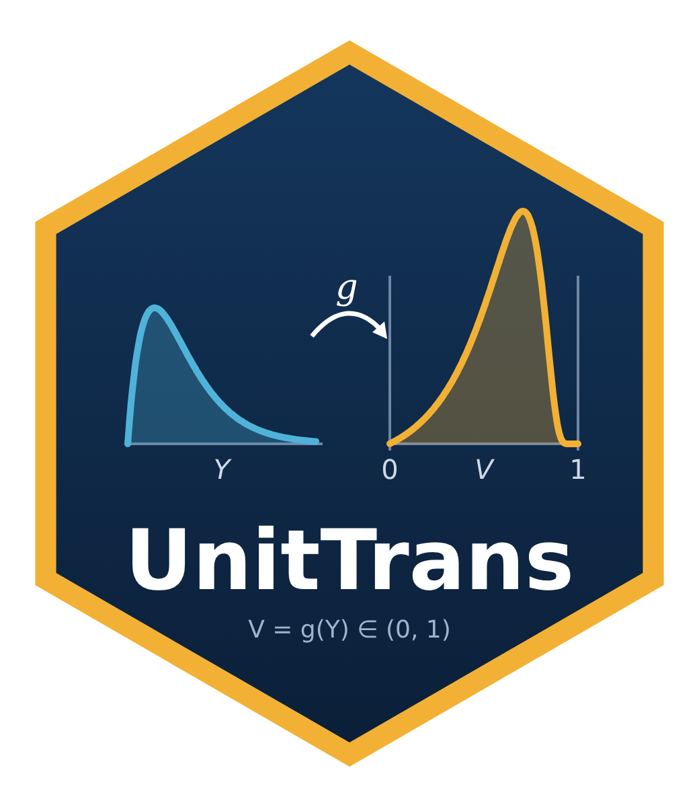

# UnitTrans 

**Distributions on the unit interval via transformations of baseline laws**

`UnitTrans` builds new probability distributions on (0, 1) by applying a monotone
transformation `V = g(Y)` — rational, exponential, logit, tanh,
probit or complementary log-log — to a baseline random variable `Y` with any
available `d/p/q/r` functions.

It provides:

- density, distribution, quantile and random generation (`dtrans`, `ptrans`, `qtrans`, `rtrans`)
- maximum-likelihood fitting with information criteria (`fit_trans`), with Wald, profile-likelihood and bootstrap confidence intervals
- automatic model search over baseline/transformation pairs, with Akaike weights (`fit_all`, `best_model`)
- goodness-of-fit tests with parametric bootstrap (`gof_trans`)
- moments, survival and hazard functions (`moments_trans`, `survival_trans`, `hazard_trans`)
- simulation studies for validating the estimator (`simulation_study`)

## Installation

```r
# install.packages("remotes")
remotes::install_github("yamenetoo/Statistical-Repository", subdir = "UnitTrans", build_vignettes = TRUE)
```

## Quick start

```r
library(UnitTrans)

set.seed(1)
x <- rtrans(300, "gamma", c(2, 1), "rational")      # simulate data on (0,1)
fit <- fit_trans(x, "gamma", "rational")            # maximum likelihood
summary(fit)
plot(fit)                                           # density, CDF, Q-Q, P-P
```

## The idea in one line

Take any baseline random variable `Y` (with `d/p/q/r` functions in R) and a monotone map `g` into (0, 1). The law of `V = g(Y)` is

$$f_V(v) = f_Y\big(g^{-1}(v)\big)\,\left|\frac{d\,g^{-1}(v)}{dv}\right|, \qquad 0 < v < 1 .$$

| Transformation | Forward `V = g(Y)` | Inverse `Y = g⁻¹(V)` | Baseline support |
|---|---|---|---|
| `rational`    | `Y / (1 + Y)`         | `V / (1 − V)`         | Y ≥ 0 |
| `exponential` | `exp(−Y)`             | `−log(V)`             | Y > 0 |
| `logit`       | `1 / (1 + exp(−Y))`   | `log(V / (1 − V))`    | real line |
| `tanh`        | `2 / (1 + exp(Y))` = `1 − tanh(Y/2)` | `log(2/V − 1)` | Y > 0 |
| `probit`      | `pnorm(Y)`            | `qnorm(V)`            | real line |
| `cloglog`     | `1 − exp(−exp(Y))`    | `log(−log(1 − V))`    | real line |

---

## Examples

### 1. Explore the available transformations

```r
library(UnitTrans)

trans_list()                       # table of all transformations

tr <- get_transformation("logit")  # a transformation object
tr                                 # prints formula, inverse, domain, monotonicity
tr$g(0)                            # 0.5
tr$ginv(0.5)                       # 0

forward_transformation(c(0.5, 1, 4), "rational")    # 0.333 0.500 0.800
inverse_transformation(c(0.2, 0.5, 0.8), "rational") # 0.25 1.00 4.00
```

### 2. Which transformations fit my baseline?

```r
baseline_params("gamma")     # "shape" "rate"
baseline_params("weibull")   # "shape" "scale"
baseline_params("norm")      # "mean"  "sd"

# check one pair
check_domain("norm", c(0, 1), "logit")      # valid
check_domain("norm", c(0, 1), "rational")   # invalid: rational needs Y >= 0

# check every transformation at once
detect_transformations("gamma", c(shape = 3, rate = 1))
detect_transformations("norm",  c(mean = 0, sd = 1))
```

### 3. Density, CDF, quantile and random numbers

```r
# Parameters can be named or given in the order of the baseline's arguments
dtrans(c(0.2, 0.5, 0.8), "gamma", c(shape = 2, rate = 1), "rational")
ptrans(c(0.2, 0.5, 0.8), "gamma", c(2, 1), "rational")
qtrans(c(0.1, 0.5, 0.9), "gamma", c(2, 1), "rational")

set.seed(42)
rtrans(10, "gamma", c(2, 1), "rational")

# log-density and upper tail
dtrans(0.3, "norm", c(0, 1), "logit", log = TRUE)
ptrans(0.3, "norm", c(0, 1), "logit", lower.tail = FALSE)

# Sanity checks: p and q are inverses, and the density integrates to 1
p <- c(0.1, 0.5, 0.9)
ptrans(qtrans(p, "weibull", c(2, 1), "exponential"), "weibull", c(2, 1), "exponential")
integrate(function(v) dtrans(v, "gamma", c(2, 1), "rational"), 0, 1)
```

### 4. Two classic special cases (uniform distribution)

```r
# Y ~ N(0,1) and V = pnorm(Y)  ->  V ~ Uniform(0,1)
dtrans(c(0.1, 0.5, 0.9), "norm", c(0, 1), "probit")    # 1 1 1

# Y ~ Logistic(0,1) and V = plogis(Y)  ->  V ~ Uniform(0,1)
dtrans(c(0.1, 0.5, 0.9), "logis", c(0, 1), "logit")    # 1 1 1

# Y ~ Exp(1) and V = exp(-Y)  ->  V ~ Uniform(0,1)
dtrans(c(0.1, 0.5, 0.9), "exp", 1, "exponential")      # 1 1 1
```

### 5. Plot a family of densities

```r
v <- seq(0.001, 0.999, length.out = 500)

plot(v, dtrans(v, "gamma", c(0.5, 1), "rational"), type = "l", lwd = 2,
     ylim = c(0, 4), xlab = "v", ylab = "density",
     main = "Gamma baseline + rational transformation")
lines(v, dtrans(v, "gamma", c(2, 1), "rational"), lwd = 2, col = 2)
lines(v, dtrans(v, "gamma", c(5, 1), "rational"), lwd = 2, col = 3)
lines(v, dtrans(v, "gamma", c(5, 5), "rational"), lwd = 2, col = 4)
legend("topright", lwd = 2, col = 1:4,
       legend = c("shape=0.5, rate=1", "shape=2, rate=1",
                  "shape=5, rate=1", "shape=5, rate=5"))
```

### 6. Same baseline, different transformations

```r
v   <- seq(0.001, 0.999, length.out = 500)
par <- c(shape = 2, rate = 1)

plot(v, dtrans(v, "gamma", par, "rational"), type = "l", lwd = 2,
     ylim = c(0, 3), xlab = "v", ylab = "density",
     main = "Gamma(2,1) under three transformations")
lines(v, dtrans(v, "gamma", par, "exponential"), lwd = 2, col = 2)
lines(v, dtrans(v, "gamma", par, "tanh"),     lwd = 2, col = 4)
legend("topright", lwd = 2, col = c(1, 2, 4),
       legend = c("rational", "exponential", "tanh"))
```

### 7. Real-line baselines: normal, logistic, Cauchy

```r
v <- seq(0.001, 0.999, length.out = 500)

plot(v, dtrans(v, "norm", c(0, 1), "logit"), type = "l", lwd = 2, ylim = c(0, 3),
     xlab = "v", ylab = "density", main = "Logit-normal family")
lines(v, dtrans(v, "norm", c(1, 0.5), "logit"),  lwd = 2, col = 2)
lines(v, dtrans(v, "norm", c(-1, 1.5), "logit"), lwd = 2, col = 3)

# heavy tails: Cauchy baseline with the cloglog map
lines(v, dtrans(v, "cauchy", c(0, 1), "cloglog"), lwd = 2, lty = 2, col = 4)
```

### 8. Fit one model by maximum likelihood

```r
set.seed(1)
x <- rtrans(500, "weibull", c(shape = 2, scale = 1.5), "exponential")

fit <- fit_trans(x, "weibull", "exponential")
fit                 # estimates, standard errors, logLik, AIC, BIC, AICc
summary(fit)        # adds Wald z-tests

coef(fit)
vcov(fit)
logLik(fit)
AIC(fit); BIC(fit)  # standard R generics work
```

### 9. Control the optimiser: starting values, bounds, multi-start

```r
set.seed(2)
x <- rtrans(300, "lnorm", c(meanlog = 0.5, sdlog = 0.8), "rational")

fit <- fit_trans(x, "lnorm", "rational",
                 start   = c(meanlog = 0, sdlog = 1),
                 lower   = c(-Inf, 1e-6),
                 upper   = c(Inf, 10),
                 n_start = 10,     # 10 starting points, best optimum kept
                 seed    = 123)
fit

# the log-likelihood at any parameter value
loglik_trans(c(0.5, 0.8), x, "lnorm", "rational")
loglik_trans(coef(fit),   x, "lnorm", "rational")
```

### 10. Confidence intervals (Wald and bootstrap)

```r
set.seed(3)
x   <- rtrans(200, "norm", c(0.5, 1.2), "logit")
fit <- fit_trans(x, "norm", "logit")

confint(fit)                                   # Wald, 95 %
confint(fit, level = 0.90)                     # Wald, 90 %
confint(fit, method = "bootstrap", B = 200)    # parametric percentile bootstrap
```

### 11. Diagnostic plots

```r
plot(fit)   # histogram + fitted density, empirical vs fitted CDF, Q-Q, P-P
```

### 12. Automatic model search over baselines × transformations

```r
set.seed(4)
x <- rtrans(400, "gamma", c(3, 2), "rational")

res <- fit_all(x,
               dists     = c("gamma", "lnorm", "weibull", "exp"),
               trans     = c("rational", "exponential", "tanh"),
               criterion = "AIC",
               verbose   = TRUE)   # report combinations that were skipped
res                 # ranking with delta-AIC
res$table           # the ranking as a data frame
names(res$fits)     # every fitted model

best <- best_model(res)               # best by AIC
best_bic <- best_model(res, "BIC")    # best by BIC
best
```

### 13. Search over real-line baselines

```r
set.seed(5)
x <- rtrans(400, "logis", c(0.3, 0.7), "logit")

res <- fit_all(x, dists = c("norm", "logis", "cauchy"),
               trans = c("logit", "probit", "cloglog"), criterion = "BIC")
res
best_model(res)
```

### 14. Goodness of fit with parametric bootstrap

```r
best <- best_model(res)
gof_trans(best, B = 200, seed = 1)          # KS, Cramer-von Mises, Anderson-Darling

# without re-estimation in each replication (faster, but conservative)
gof_trans(best, B = 200, refit = FALSE, seed = 1)

# a wrong model should be rejected
wrong <- fit_trans(x, "cauchy", "probit")
gof_trans(wrong, B = 200, seed = 1)
```

### 15. Moments, mean, variance, skewness, kurtosis

```r
moments_trans("gamma", c(2, 1), "rational", r = 1:4)   # raw moments E[V^r]
summary_trans("gamma", c(2, 1), "rational")            # mean, variance, skewness, ex.kurtosis

# compare with a large simulated sample
set.seed(6)
x <- rtrans(1e5, "gamma", c(2, 1), "rational")
c(mean = mean(x), variance = var(x))

# moments of a fitted model
summary_trans(best$dist, best$coef, best$trans)
```

### 16. Survival and hazard functions

```r
v <- c(0.1, 0.3, 0.5, 0.7, 0.9)
survival_trans(v, "weibull", c(2, 1), "rational")
hazard_trans(v,   "weibull", c(2, 1), "rational")

vv <- seq(0.01, 0.99, length.out = 300)
plot(vv, hazard_trans(vv, "weibull", c(0.8, 1), "rational"), type = "l", lwd = 2,
     log = "y", xlab = "v", ylab = "hazard", main = "Hazard rate shapes")
lines(vv, hazard_trans(vv, "weibull", c(2, 1), "rational"), lwd = 2, col = 2)
lines(vv, hazard_trans(vv, "weibull", c(4, 1), "rational"), lwd = 2, col = 4)
legend("topleft", lwd = 2, col = c(1, 2, 4), legend = paste("shape =", c(0.8, 2, 4)))
```

### 17. Monte Carlo study of the estimator

```r
sim <- simulation_study("gamma", c(shape = 2, rate = 1), "rational",
                        n = c(50, 100, 200, 500), R = 200, seed = 1)
sim   # bias, RMSE and coverage of 95 % Wald intervals for each n and parameter

# RMSE against sample size
with(subset(sim, parameter == "shape"),
     plot(n, rmse, type = "b", log = "xy", main = "RMSE of shape"))
```

### 18. Check that random numbers follow the model

```r
set.seed(7)
x <- rtrans(2000, "gamma", c(2, 1), "tanh")
ks.test(x, function(q) ptrans(q, "gamma", c(2, 1), "tanh"))

hist(x, breaks = 40, probability = TRUE, main = "rtrans() vs dtrans()")
curve(dtrans(x, "gamma", c(2, 1), "tanh"), add = TRUE, lwd = 2, col = 2)
```

### 19. Baselines from `extraDistr`

Any distribution in `extraDistr` is found automatically (no `library()` needed):

```r
# install.packages("extraDistr")
baseline_params("rayleigh")                            # "sigma"
dtrans(c(0.2, 0.5), "rayleigh", c(sigma = 1), "rational")

set.seed(8)
x <- rtrans(300, "rayleigh", c(sigma = 1.5), "exponential")
fit_trans(x, "rayleigh", "exponential")
```

### 20. Your own baseline distribution

Write `d`, `p` and `q` functions with the usual R signatures and pass the name:

```r
# an exponential written by hand, parameter "lambda"
dmyexp <- function(x, lambda, log = FALSE) dexp(x, rate = lambda, log = log)
pmyexp <- function(q, lambda, lower.tail = TRUE) pexp(q, rate = lambda, lower.tail = lower.tail)
qmyexp <- function(p, lambda) qexp(p, rate = lambda)

baseline_params("myexp")                       # "lambda"
dtrans(c(0.2, 0.5), "myexp", c(lambda = 2), "rational")

set.seed(9)
x <- rtrans(300, "myexp", c(lambda = 2), "rational")
fit_trans(x, "myexp", "rational")
```

### 21. A complete workflow on your own data

```r
# 'y' are proportions, rates or scores strictly inside (0, 1)
y <- your_data
y <- y[y > 0 & y < 1]

res  <- fit_all(y, c("gamma", "lnorm", "weibull", "exp", "norm", "logis"),
                criterion = "AIC")            # all six transformations
res
best <- best_model(res)
summary(best)
plot(best)
gof_trans(best, B = 500, seed = 1)
confint(best, method = "bootstrap", B = 500)
summary_trans(best$dist, best$coef, best$trans)
```

### 22. Profile-likelihood intervals, residuals and prediction

```r
set.seed(3)
x   <- rtrans(200, "weibull", c(2, 1.5), "exponential")
fit <- fit_trans(x, "weibull", "exponential")

confint(fit, method = "profile")        # profile likelihood (good for positive parameters)
confint(fit, parm = "shape")            # a single parameter (Wald)

r <- residuals(fit)                     # normalised quantile residuals ~ N(0,1)
qqnorm(r); qqline(r)
nobs(fit)
predict(fit, c(.2, .5), type = "cdf")   # also "density" and "quantile"
```

### 23. Data containing exact 0 or 1

```r
y <- c(0, 1, x)
fit_trans(y, "weibull", "exponential", adjust = TRUE)   # Smithson-Verkuilen correction
```

### 24. Accurate tails

`ptrans()` and `qtrans()` accept `lower.tail` and `log.p`, and the upper tail is
computed directly from the baseline (not as `1 - p`), so survival and hazard
functions stay accurate close to 1.

```r
ptrans(1 - 1e-12, "lnorm", c(0, 1), "rational", lower.tail = FALSE)
hazard_trans(1 - 1e-12, "lnorm", c(0, 1), "rational")
```

---

## Running the tests

```sh
R CMD build UnitTrans
R CMD check UnitTrans_0.2.0.tar.gz
```

or inside R: `testthat::test_local()`.

## Author

Mohamad Yamen Al-Mohamad — Department of Statistics, University of Tabriz

## License

GPL-3
