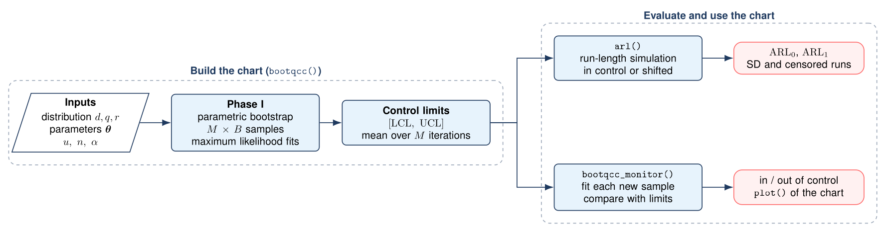
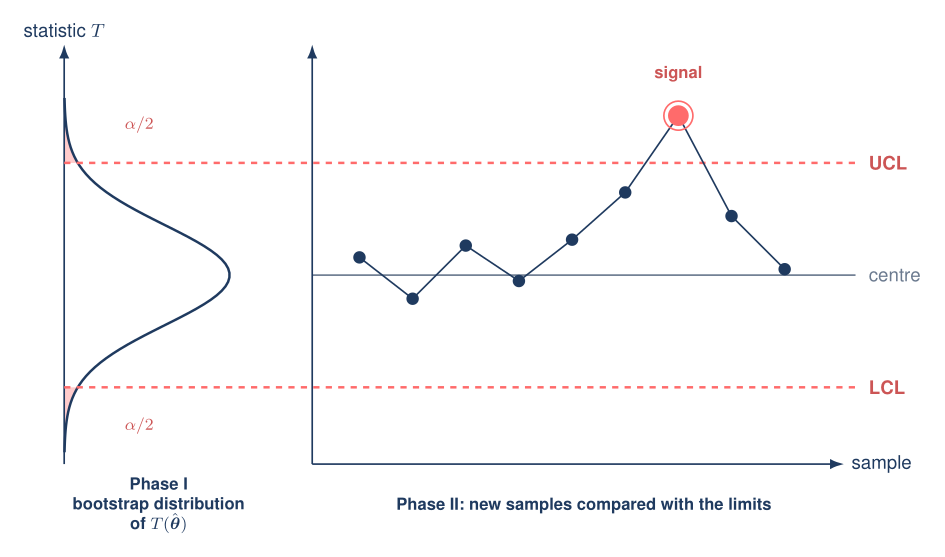
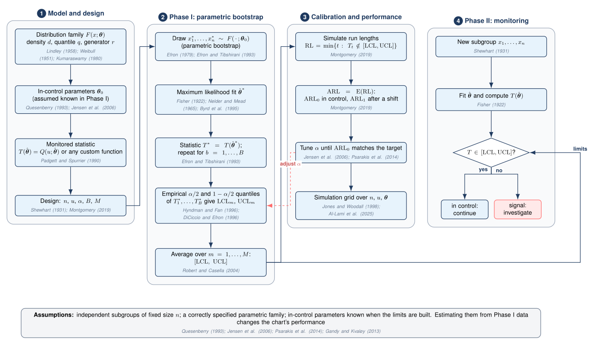
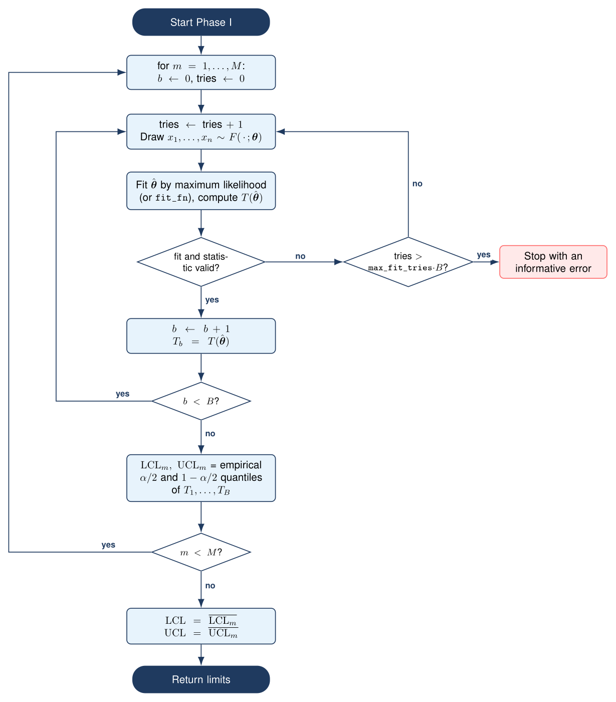
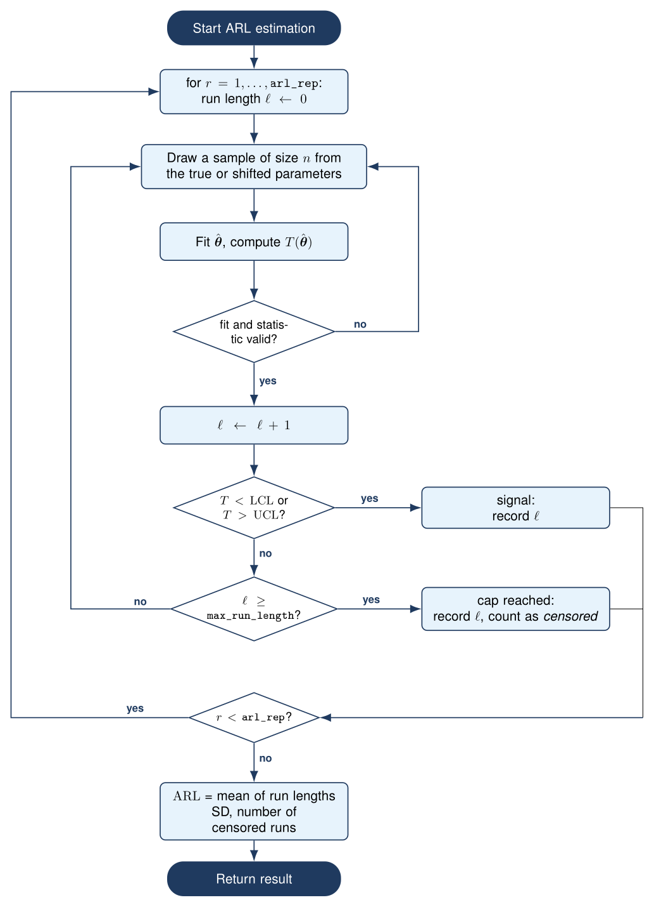
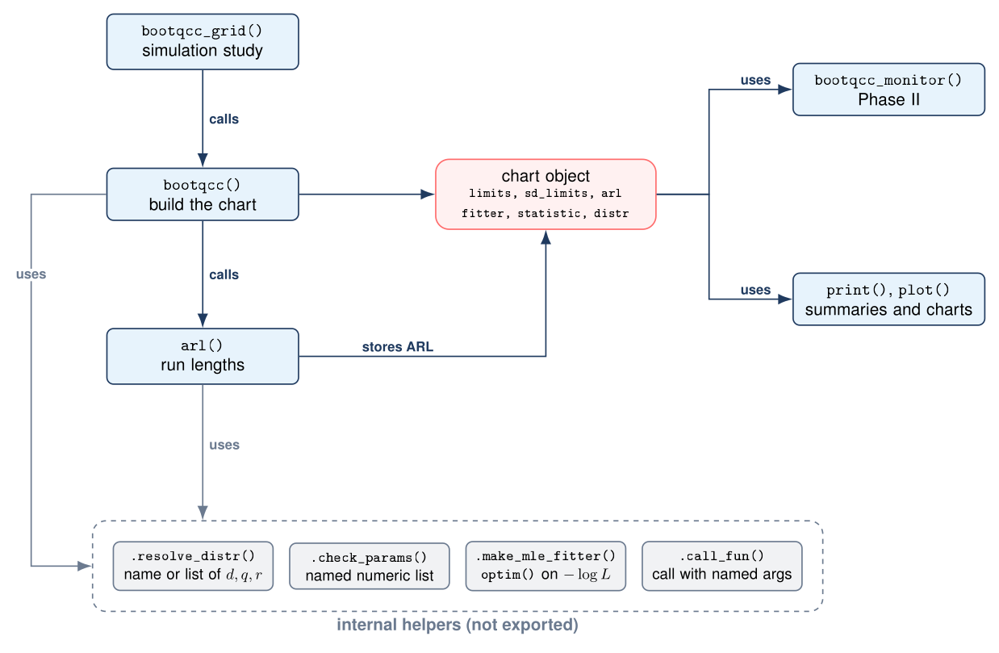
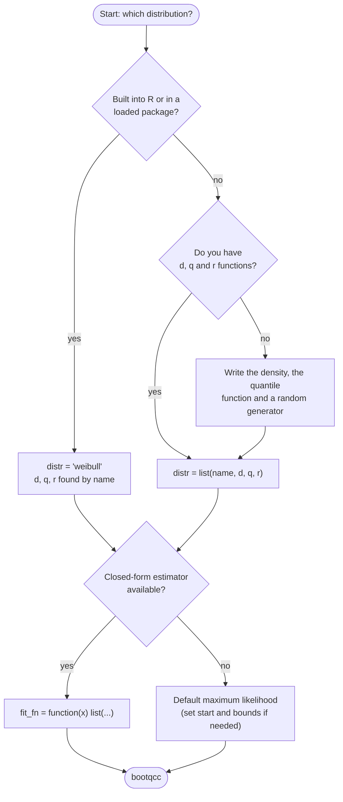
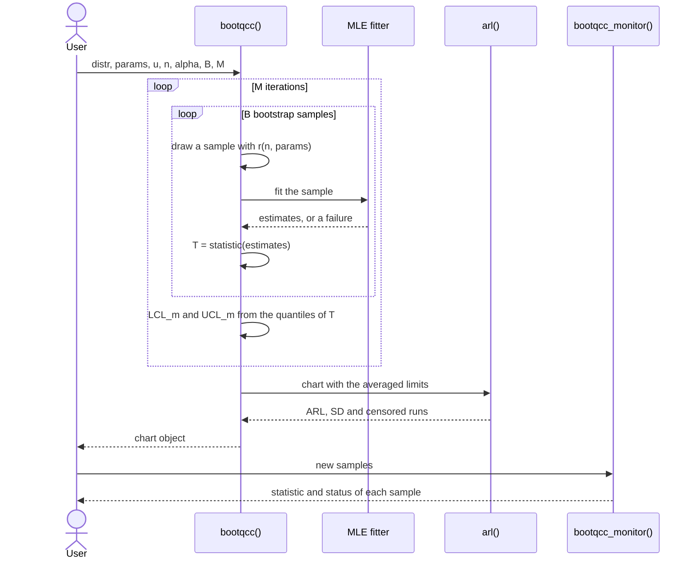
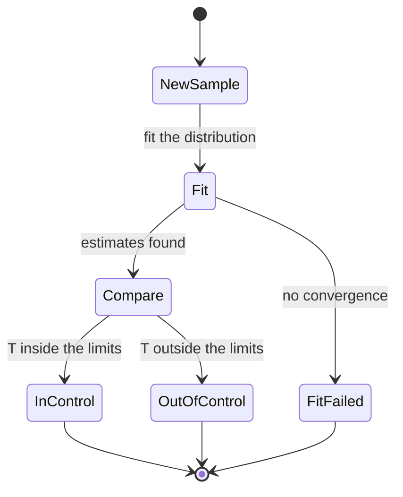
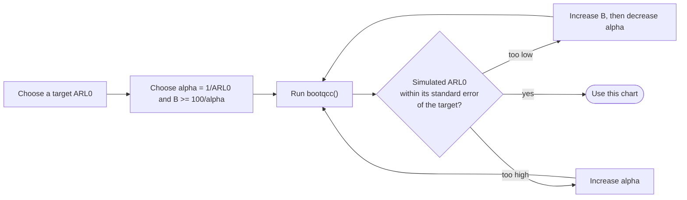

<div align="center">


# bootqcc

**Parametric bootstrap control charts for any distribution**

[](#installation)
[](DESCRIPTION)
[](LICENSE)
[](#testing)
[](tests/testthat)

</div>

---

## Contents

1. [Overview](#overview)
2. [Why bootqcc](#why-bootqcc)
3. [How it works](#how-it-works)
4. [Methodology](#methodology)
5. [Diagrams and flowcharts](#diagrams-and-flowcharts)
6. [Installation](#installation)
7. [Quick start](#quick-start)
8. [Using your own distribution](#using-your-own-distribution)
9. [Reproducing the Lindley-geometric chart](#reproducing-the-lindley-geometric-chart)
10. [Out-of-control performance and Phase II](#out-of-control-performance-and-phase-ii)
11. [Unknown parameters: building the chart from Phase I data](#unknown-parameters-building-the-chart-from-phase-i-data)
12. [Validation against exact results](#validation-against-exact-results)
13. [Calibrating the false-alarm rate](#calibrating-the-false-alarm-rate)
14. [Other statistics and estimators](#other-statistics-and-estimators)
15. [Simulation studies over a grid](#simulation-studies-over-a-grid)
16. [Function reference](#function-reference)
17. [Argument reference for `bootqcc()`](#argument-reference-for-bootqcc)
18. [What the result contains](#what-the-result-contains)
19. [Tips for speed and reproducibility](#tips-for-speed-and-reproducibility)
20. [Troubleshooting](#troubleshooting)
21. [Limitations](#limitations)
22. [Roadmap](#roadmap)
23. [Testing](#testing)
24. [Relation to the original code](#relation-to-the-original-code)
25. [References](#references)
26. [Citation](#citation)
27. [Author and license](#author-and-license)

---

## Overview

`bootqcc` builds **Phase I control limits** for a quantile (or any statistic
of your choice) of a parametric distribution using the **parametric
bootstrap** (Efron 1979; Efron and Tibshirani 1993) and **maximum likelihood
estimation** (Fisher 1922). It then evaluates the chart
by Monte Carlo estimates of the **average run length (ARL)**, and can monitor
new samples in **Phase II**.

The idea comes from control charts for lifetime and reliability data, where
the quantity of interest is a *percentile* of a skewed distribution, not a
mean, and where a classical Shewhart chart (Shewhart 1931; Montgomery 2019) is
a poor fit. Percentile charts for strength data go back to Padgett and
Spurrier (1990), and bootstrap charts to Seppala et al. (1995) and Jones and
Woodall (1998). The original code in
this repository solved the problem for one family, the Lindley-geometric
distribution. `bootqcc` generalizes it: **any family with density, quantile and
random-generation functions works**, whether it is built into R or defined by
you.

## Why bootqcc

| You have | Without bootqcc | With bootqcc |
|---|---|---|
| A new lifetime distribution | Rewrite the whole chart code for it | Pass its `d`, `q`, `r` functions |
| A built-in family (Weibull, gamma, log-normal, ...) | Write and debug a bootstrap loop | `bootqcc("weibull", ...)` |
| A statistic other than a quantile | Modify the internals | `statistic = function(est) ...` |
| A special estimator | Modify the internals | `fit_fn = function(x) ...` |
| A simulation study for a paper | Hand-written nested loops | `bootqcc_grid()` |
| Samples to monitor | Manual bookkeeping | `bootqcc_monitor()` and `plot()` |

It is also defensive: failed fits are redrawn (within a bound, with a clear
error), run lengths are capped, and capped runs are *reported* so an unreliable
ARL is never silent.

## How it works

Let `T(θ̂)` be the monitored statistic computed from fitted parameters `θ̂`.
By default `T` is the `u`-quantile of the fitted distribution, `Q(u; θ̂)`
(Padgett and Spurrier 1990). The full mathematical statement, with references
for every step, is in [Methodology](#methodology).

For each Monte Carlo iteration `m = 1, ..., M`:

1. Draw `B` samples of size `n` from the distribution with the in-control
   parameters `θ`.
2. Fit the distribution to each sample by maximum likelihood (Fisher 1922),
   giving `θ̂₁, ..., θ̂_B`.
3. Compute `T₁, ..., T_B` with `T_b = T(θ̂_b)`.
4. Record the empirical `α/2` and `1 − α/2` quantiles of the `T_b` (Hyndman
   and Fan 1996, type 7) as one lower and one upper limit, `LCL_m` and `UCL_m`.

The reported control limits are the averages over the `M` iterations,

```
LCL = (1/M) Σ LCL_m        UCL = (1/M) Σ UCL_m
```

and their standard deviations over `m` tell you how stable the limits are.
Averaging over `M` iterations reduces the Monte Carlo noise in the limits.

**Phase II / ARL.** Samples of size `n` are drawn repeatedly, the distribution
is fitted to each, and `T(θ̂)` is compared with `[LCL, UCL]`. The run length is
the number of samples up to and including the first signal. Repeating this
`arl_rep` times gives the ARL and its standard deviation. Drawing from shifted
parameters gives the out-of-control ARL.

<div align="center">



*Workflow: the limits are built once by `bootqcc()`, then used to evaluate the ARL and to monitor new samples.*



*The `alpha/2` and `1 - alpha/2` quantiles of the bootstrap distribution (left) become the control limits of the Phase II chart (right).*

</div>

## Methodology

<div align="center">



*General methodology of `bootqcc`. Each box carries the literature behind that step (author-year, full entries in the [References](#references)).*

</div>

The methodology has four stages: (1) model and design, (2) Phase I parametric
bootstrap, (3) calibration and performance evaluation, (4) Phase II
monitoring. The mathematics of each stage follows.

### 1. Model and design

Subgroups $\mathbf{x}=(x_1,\dots,x_n)$ are independent and identically
distributed with distribution function $F(x;\boldsymbol\theta)$, density $f$,
quantile function $Q(p;\boldsymbol\theta)=F^{-1}(p;\boldsymbol\theta)$ and
random generator $r$. Typical lifetime families are the Weibull (Weibull 1951),
Kumaraswamy (Kumaraswamy 1980) and Lindley-type (Lindley 1958) models. The
in-control parameters are $\boldsymbol\theta_0$. The design constants are the
subgroup size $n$, the monitored quantile level $u$, the false-alarm level
$\alpha$, the number of bootstrap replicates $B$ and the number of Monte Carlo
repetitions $M$. Charts for a percentile of a lifetime distribution follow
Padgett and Spurrier (1990).

### 2. Phase I: the parametric bootstrap

**Estimation.** For a sample $\mathbf{x}$ the maximum likelihood estimate
(Fisher 1922) is

$$
\hat{\boldsymbol\theta}(\mathbf{x})=\arg\max_{\boldsymbol\theta}\ \sum_{i=1}^{n}\log f(x_i;\boldsymbol\theta),
$$

computed numerically by minimizing the negative log-likelihood with
`optim()`; the default is the Nelder-Mead simplex method (Nelder and Mead 1965)
and a box-constrained method such as L-BFGS-B (Byrd et al. 1995) can be chosen
through `optim_method`, `lower` and `upper`.

**Monitored statistic.** By default
$T(\hat{\boldsymbol\theta})=Q(u;\hat{\boldsymbol\theta})$. By the invariance
property of maximum likelihood estimators (Casella and Berger 2002, Thm. 7.2.10)
this is the maximum likelihood estimator of the $u$-quantile. Any other function
of $\hat{\boldsymbol\theta}$ can be supplied through `statistic`.

**Bootstrap distribution.** The distribution of $T$ under the in-control model is
approximated by simulation (Efron 1979; Efron and Tibshirani 1993). For
$b=1,\dots,B$: draw $x^*_{b1},\dots,x^*_{bn}\sim F(\cdot;\boldsymbol\theta_0)$,
fit $\hat{\boldsymbol\theta}^*_b$, and set $T^*_b=T(\hat{\boldsymbol\theta}^*_b)$.

**Control limits.** With $\hat F^*_T$ the empirical distribution function of
$T^*_1,\dots,T^*_B$,

$$
\mathrm{LCL}_m=\hat F^{*-1}_T(\alpha/2),\qquad \mathrm{UCL}_m=\hat F^{*-1}_T(1-\alpha/2),
$$

using the default quantile definition (type 7, Hyndman and Fan 1996). This is
the percentile method for bootstrap intervals (DiCiccio and Efron 1996). Repeating
the construction $M$ times and averaging reduces Monte Carlo noise
(Robert and Casella 2004):

$$
\mathrm{LCL}=\frac1M\sum_{m=1}^{M}\mathrm{LCL}_m,\qquad
\mathrm{UCL}=\frac1M\sum_{m=1}^{M}\mathrm{UCL}_m .
$$

**Resolution of the tail quantiles.** An empirical quantile at level $p=\alpha/2$
is based on about $Bp$ points, and its asymptotic variance is
$p(1-p)/\{B f_T(q_p)^2\}$ (Serfling 1980, Sec. 2.3.3), so its relative precision
is of order $1/\sqrt{B\alpha/2}$. A small $B\alpha/2$ makes the limits both noisy
and too narrow (a finite sample rarely contains its own extreme tail), and the
in-control ARL then falls below $1/\alpha$. This is why the package warns when
$B\alpha/2<5$ and why $B\ge 10/\alpha$ (preferably $100/\alpha$) is recommended.

### 3. Run length and ARL

The chart signals at the first $t$ with $T_t\notin[\mathrm{LCL},\mathrm{UCL}]$,
so the run length is

$$
\mathrm{RL}=\min\{t\ge 1:\ T_t<\mathrm{LCL}\ \text{or}\ T_t>\mathrm{UCL}\}.
$$

For fixed limits and independent subgroups, $\mathrm{RL}$ is geometric,
$P(\mathrm{RL}=t)=(1-p)^{t-1}p$, where $p=P(T\notin[\mathrm{LCL},\mathrm{UCL}])$
is the probability that one subgroup signals, so (Montgomery 2019)

$$
\mathrm{ARL}=\operatorname{E}(\mathrm{RL})=\frac1p,\qquad
\operatorname{SD}(\mathrm{RL})=\frac{\sqrt{1-p}}{p}.
$$

With the exact $\alpha/2$ and $1-\alpha/2$ quantiles of $T$ and known parameters,
$p=\alpha$ and $\mathrm{ARL}_0=1/\alpha$. `bootqcc` estimates the ARL by
Monte Carlo: it simulates `arl_rep` run lengths, reports their mean
$\widehat{\mathrm{ARL}}$ and standard deviation $s$, and the standard error of the
estimate is $s/\sqrt{\texttt{arl\_rep}}$. Because $\operatorname{SD}(\mathrm{RL})\approx
\operatorname{E}(\mathrm{RL})$ for small $p$, the relative error is about
$1/\sqrt{\texttt{arl\_rep}}$: 100 runs give roughly $\pm 10\%$, 1000 runs roughly
$\pm 3\%$. Runs are capped at `max_run_length` and counted as censored.
For the out-of-control ARL, $\mathrm{ARL}_1$, the samples are drawn from shifted
parameters (Montgomery 2019).

### 4. Phase II monitoring

For each new subgroup the model is fitted, $T(\hat{\boldsymbol\theta})$ is
computed and compared with $[\mathrm{LCL},\mathrm{UCL}]$ (Shewhart 1931). A
point outside the limits is a signal.

### 5. Unknown parameters: the effect of estimation

When $\boldsymbol\theta_0$ is not known and the limits are built from a Phase I
estimate $\hat{\boldsymbol\theta}$ of finite size $N$, the false-alarm probability
of the chart *given the Phase I sample*,

$$
p(\hat{\boldsymbol\theta})=P\{T\notin[\mathrm{LCL}(\hat{\boldsymbol\theta}),\mathrm{UCL}(\hat{\boldsymbol\theta})]\mid\hat{\boldsymbol\theta}\},
$$

is random. The conditional run length is geometric with mean $1/p(\hat{\boldsymbol\theta})$,
and the unconditional ARL is $\operatorname{E}\{1/p(\hat{\boldsymbol\theta})\}$,
which is smaller than $1/\alpha$ (Quesenberry 1993; Jensen et al. 2006; Psarakis
et al. 2014). For a given Phase I sample the chart can alarm much more often than
nominal, and a large Phase I sample is needed to avoid this (Saleh et al. 2015).
Gandy and Kvaloy (2013) propose bootstrap limits whose conditional performance is
guaranteed with a chosen probability.
[`bootqcc_phase1()`](#unknown-parameters-building-the-chart-from-phase-i-data)
implements a version of this idea.

### Step-to-reference map

| Step | Where in the code | Source |
|---|---|---|
| Shewhart-type chart, Phase I and II | `bootqcc()`, `bootqcc_monitor()` | Shewhart (1931); Montgomery (2019) |
| Percentile (quantile) chart for lifetime data | default `statistic` | Padgett and Spurrier (1990) |
| Bootstrap control charts | Phase I loop | Seppala et al. (1995); Jones and Woodall (1998) |
| Parametric bootstrap | `r(n, theta0)` draws | Efron (1979); Efron and Tibshirani (1993) |
| Maximum likelihood estimation | `.make_mle_fitter()` | Fisher (1922) |
| Optimization | `optim()` Nelder-Mead / L-BFGS-B | Nelder and Mead (1965); Byrd et al. (1995) |
| Invariance of the MLE (quantile as a function of $\hat\theta$) | `Q(u; theta_hat)` | Casella and Berger (2002) |
| Percentile limits from the bootstrap distribution | `quantile()` | DiCiccio and Efron (1996); Hyndman and Fan (1996) |
| Averaging over $M$ Monte Carlo repetitions | `mean(lcl_runs)` | Robert and Casella (2004) |
| Precision of tail quantiles, rule for $B$ | warning in `bootqcc()` | Serfling (1980) |
| Run length, ARL, geometric distribution | `arl()` | Montgomery (2019) |
| Effect of parameter estimation | `bootqcc_phase1()` | Quesenberry (1993); Jensen et al. (2006); Psarakis et al. (2014); Saleh et al. (2015) |
| Bootstrap guarantee on conditional performance | `adjust = "quantile"` | Gandy and Kvaloy (2013) |
| Lindley-geometric chart (origin of the original code) | `LGBootStrapControlChart` | Al-Lami et al. (2025) |

## Diagrams and flowcharts

All figures below are included in the repository. The TikZ sources are in
[`docs/tikz`](docs/tikz) (PDF versions next to them), and the diagrams written
in Mermaid are rendered directly by GitHub.

### Phase I: bootstrap algorithm

<div align="center">



</div>

Every attempt to draw and fit a sample counts towards a budget of
`max_fit_tries * B` tries per Monte Carlo iteration. Failed fits are redrawn
until the budget is used up, which stops the run with an informative error
instead of looping forever.

### Run length (ARL) algorithm

<div align="center">



</div>

A failed fit does not count as a sample: the run length only increases when a
valid statistic has been computed. A run that reaches `max_run_length` without
a signal is recorded at the cap and reported as *censored*.

### Package architecture

<div align="center">



</div>

### Choosing how to specify your distribution



### A typical session



### What happens to a new sample in Phase II



### Rebuilding the TikZ figures

```bash
cd docs/tikz
./build.sh          # needs pdflatex with TikZ and pdftocairo
```

This writes the PDF next to each `.tex` file and the PNG used in this README to
`man/figures`. The figures share the colors and styles defined in
[`docs/tikz/preamble.tex`](docs/tikz/preamble.tex). To use a figure in a paper,
include the PDF with `\includegraphics`, or copy the `tikzpicture` environment
together with the style definitions from the preamble.

## Installation

From GitHub (the package lives in a subfolder of this repository):

```r
# install.packages("remotes")
remotes::install_github("yamenetoo/Statistical-Repository", subdir = "bootqcc",
                        build_vignettes = TRUE)
```

From a downloaded source archive:

```r
install.packages("bootqcc_0.1.0.tar.gz", repos = NULL, type = "source")
```

The package depends only on base R (`stats` and `graphics`). No compiled code
is needed.

## Quick start

```r
library(bootqcc)

ch <- bootqcc("weibull",
              params = list(shape = 2, scale = 1),
              u = 0.1,         # monitor the 10% quantile
              n = 5,           # subgroup size
              alpha = 0.01,    # false-alarm probability used for the limits
              B = 2000,        # bootstrap replicates; keep B * alpha / 2 >= 5
              M = 10, arl_rep = 200, seed = 1)
ch
```

Output (real run; the in-control ARL should be close to `1/alpha = 100`, and 92.9 with a
standard error of about 6 agrees):

```
Parametric bootstrap control chart
Distribution : weibull (shape = 2, scale = 1)
Statistic    : 0.1-quantile, subgroup size n = 5
Settings     : alpha = 0.01, B = 2000, M = 10
LCL = 0.07589 (SD 0.006578)
UCL = 1.004 (SD 0.03429)
In-control ARL = 92.94 (SD 89.65) from 200 runs
```

Any family works as long as `d<name>`, `q<name>` and `r<name>` exist in your
session: `"weibull"`, `"gamma"`, `"lnorm"`, `"exp"`, `"logis"`, `"norm"`, and
the families of any package you have loaded.

To look at the bootstrap distribution of the statistic with the limits:

```r
plot(ch)
```

## Using your own distribution

Pass a list with the functions `d`, `q` and `r` (and an optional `name`). Each
function takes the data, the sample size, or the probabilities as its first
argument, followed by the parameters **by name**:

```r
kw <- list(
  name = "kumaraswamy",
  d = function(x, a, b) a * b * x^(a - 1) * (1 - x^a)^(b - 1),
  q = function(p, a, b) (1 - (1 - p)^(1 / b))^(1 / a),
  r = function(n, a, b) (1 - (1 - runif(n))^(1 / b))^(1 / a)
)

ch <- bootqcc(kw, params = list(a = 2, b = 3), u = 0.5, n = 15, seed = 1)
```

Alternatively, define functions named `d<name>`, `q<name>` and `r<name>` in your
session and refer to the family by `name`, exactly like the built-in ones:

```r
dmydist <- function(x, lambda, k) { ... }
qmydist <- function(p, lambda, k) { ... }
rmydist <- function(n, lambda, k) { ... }

bootqcc("mydist", list(lambda = 1, k = 2), u = 0.99, n = 5)
```

Requirements for the functions:

- `d` must return a positive density at points inside the support and may
  return `0`, `NaN` or an error outside it (these are treated as invalid
  parameter values by the optimizer);
- `q` and `r` must accept the same named parameters as `d`;
- parameter names in `params` (and `start`) must match the argument names.

## Reproducing the Lindley-geometric chart

The original code in `LGBootStrapControlChart` used the
[`LindleyPowerSeries`](https://cran.r-project.org/package=LindleyPowerSeries)
package. The same chart with `bootqcc`:

```r
library(LindleyPowerSeries)

lg <- list(
  name = "lindleygeometric",
  d = function(x, theta, p) dlindleygeometric(x, theta, p),
  q = function(u, theta, p) qlindleygeometric(u, theta, p),
  r = function(n, theta, p) rlindleygeometric(n, theta, p)
)

ch <- bootqcc(lg, params = list(theta = 2, p = 0.8),
              u = 0.99, alpha = 0.07, n = 5,
              B = 10000, M = 20, arl_rep = 1000,
              start = list(theta = 0.5, p = 0.01))
```

> This snippet mirrors the call in the original `example.R`. It was not run
> while preparing this README because `LindleyPowerSeries` was not available
> in the build environment; verify the numbers against the original script
> before using them in a publication.

## Out-of-control performance and Phase II

**ARL after a shift.** Simulate from shifted parameters to estimate the
out-of-control ARL:

```r
for (sc in c(1, 1.2, 1.5, 2)) {
  a <- arl(ch, params = list(shape = 2, scale = sc), rep = 200)
  cat(sprintf("scale = %.1f  ARL = %.1f\n", sc, a$mean))
}
```

Output (real run, with the chart above):

```
scale = 1.0  ARL = 88.5
scale = 1.2  ARL = 31.9
scale = 1.5  ARL = 9.6
scale = 2.0  ARL = 3.1
```

**Monitoring new samples.** One sample per row (a matrix or data frame), or a
list of numeric vectors:

```r
new <- rbind(matrix(rweibull(15, 2, 1), ncol = 5),   # in control
             matrix(rweibull(10, 2, 3), ncol = 5))   # scale tripled
bootqcc_monitor(ch, new)
plot(ch, data = new)       # draws the Phase II control chart
```

```
  sample statistic        LCL      UCL         status
1      1 0.8414807 0.07589485 1.003706     in control
2      2 0.4251076 0.07589485 1.003706     in control
3      3 0.2113204 0.07589485 1.003706     in control
4      4 0.8812365 0.07589485 1.003706     in control
5      5 1.4582266 0.07589485 1.003706 out of control
```

Samples for which no fit could be obtained are labelled `"fit failed"`
instead of being silently dropped.

## Unknown parameters: building the chart from Phase I data

`bootqcc()` simulates from parameters you give. In practice you have a Phase I
sample, and the limits built from its estimates have a random false-alarm
rate. `bootqcc_phase1()` takes the raw Phase I data, estimates the parameters by
maximum likelihood, builds the bootstrap limits, and measures (and optionally
corrects) the effect of the estimation by an outer bootstrap. It returns an object that works
with `bootqcc_monitor()`, `arl()` and `plot()`.

```r
set.seed(1)
phase1 <- matrix(rexp(20 * 5, rate = 1), ncol = 5)      # 20 subgroups of size 5
ch <- bootqcc_phase1(phase1, "exp", u = 0.5, alpha = 0.0027,
                     fit_fn = function(x) list(rate = 1 / mean(x)),
                     B = 3000, R = 100, N_ref = 20000,
                     adjust = "mean", seed = 2)
ch
```

Output (real run, about 16 seconds):

```
Parametric bootstrap control chart from Phase I data
Distribution : exp, estimated from N = 100 observations
Estimates    : rate = 0.9702
Statistic    : 0.5-quantile, subgroup size n = 5
Nominal alpha = 0.0027; adjustment = mean; level used = 0.0012
LCL = 0.1102, UCL = 2.291  (unadjusted: 0.1234, 2.073)
Conditional false-alarm probability at the nominal level: mean 0.00493, 90% quantile 0.00823
                       at the level used:               mean 0.0027, 90% quantile 0.00451
```

(A warning that $B\alpha/2=4<5$ was also printed in this run; use `B >= 3704` for
final results.) With the nominal level the average false-alarm probability is
almost twice the target, and the chart is made wider by using the level
$\alpha'=0.0012$.

**How it works** (details in [Methodology](#5-unknown-parameters-the-effect-of-estimation)).

1. Fit $\hat\theta$ from the Phase I data and draw a reference sample of
   in-control statistics from $F(\cdot;\hat\theta)$.
2. Repeat `R` times: simulate a Phase I sample of the same size from
   $F(\cdot;\hat\theta)$, re-estimate, build the bootstrap limits from the
   re-estimated parameters, and record the conditional false-alarm probability
   $p_r(\alpha')$ of those limits on the reference sample.
3. `adjust = "none"` only reports the distribution of $p_r$; `"mean"` lowers
   the level $\alpha'$ until $\operatorname{mean}_r p_r(\alpha')=\alpha$; `"quantile"` lowers it
   until $p_r(\alpha')\le\alpha$ for a share `prob` of the Phase I samples
   (Gandy and Kvaloy 2013).

| Argument | Meaning |
|---|---|
| `data` | matrix (one subgroup per row) or vector with `n` given |
| `B` | bootstrap replicates for the limits (default `max(1000, 20/alpha)`) |
| `R` | outer replicates that resample the Phase I estimation |
| `N_ref` | size of the reference sample of in-control statistics |
| `adjust`, `prob` | `"none"`, `"mean"` or `"quantile"`; probability for the quantile criterion |
| `start` or `fit_fn` | starting values for numerical MLE, or a closed-form estimator |

The cost is about `R * B + N_ref` fits, so use a closed-form `fit_fn` for large
problems. The result also contains `params_hat`, `limits_unadjusted`,
`alpha_adj`, `alpha_mean`, `alpha_quantile`, and the conditional probabilities
`fap` for each outer replicate.

> **What is and is not corrected.** The procedure assumes that the model is
> right and that the Phase I data are in control. It takes the estimate as the
> truth inside the bootstrap world, so it is approximate when $N$ is small, and
> it is assessed in the next section against an exact benchmark.

## Validation against exact results

The exponential distribution gives a benchmark with closed forms. For
$X\sim\mathrm{Exp}(1)$ the MLE of the rate is $1/\bar x$, so
$T=-\log(1-u)\,\bar x$ with $\bar x\sim\mathrm{Gamma}(n,\ \text{scale}=1/n)$. The exact limits are
$-\log(1-u)\,\{q_{\alpha/2},q_{1-\alpha/2}\}$ of that gamma law, the exact in-control ARL is $1/\alpha$,
and the distribution of the conditional false-alarm probability under estimation
is also available in closed form. Everything below is reproduced by
[`inst/validation/exponential-validation.R`](inst/validation/exponential-validation.R)
(about 25 minutes); the raw results are in `inst/validation/exponential-validation.rds`.
The settings are $n=5$, $u=0.5$, $M=10$ and 2000 simulated runs per ARL.

### A. Known parameters

Bootstrap limits and ARL0 (standard error in brackets) against the exact values:

| alpha | B | B·alpha/2 | LCL | LCL exact | UCL | UCL exact | ARL0 | 1/alpha |
|---|---|---|---|---|---|---|---|---|
| 0.1 |    100 | 5 | 0.2900 | 0.2731 | 1.2240 | 1.2689 | 8.1 (0.2) | 10 |
| 0.1 |   1,000 | 50 | 0.2730 | 0.2731 | 1.2538 | 1.2689 | 9.9 (0.2) | 10 |
| 0.1 |  10,000 | 500 | 0.2743 | 0.2731 | 1.2635 | 1.2689 | 10.0 (0.2) | 10 |
| 0.1 | 100,000 | 5,000 | 0.2728 | 0.2731 | 1.2699 | 1.2689 | 10.1 (0.2) | 10 |
| 0.01 |    100 | 0.5 | 0.1869 | 0.1494 | 1.6676 | 1.7459 | 52.4 (1.1) | 100 |
| 0.01 |   1,000 | 5 | 0.1485 | 0.1494 | 1.7169 | 1.7459 | 96.9 (2.2) | 100 |
| 0.01 |  10,000 | 50 | 0.1490 | 0.1494 | 1.7343 | 1.7459 | 101.5 (2.4) | 100 |
| 0.01 | 100,000 | 500 | 0.1496 | 0.1494 | 1.7479 | 1.7459 | 103.2 (2.3) | 100 |
| 0.0027 |    100 | 0.135 | 0.1738 | 0.1098 | 1.7954 | 1.9952 | 78.3 (1.7) | 370.4 |
| 0.0027 |   1,000 | 1.35 | 0.1177 | 0.1098 | 1.9658 | 1.9952 | 293.3 (6.6) | 370.4 |
| 0.0027 |  10,000 | 13.5 | 0.1122 | 0.1098 | 1.9749 | 1.9952 | 328.9 (7.3) | 370.4 |
| 0.0027 | 100,000 | 135 | 0.1096 | 0.1098 | 1.9980 | 1.9952 | 379.6 (8.5) | 370.4 |

* The limits converge to the exact limits as $B$ grows, and ARL0 converges to
  $1/\alpha$ (for example 379.6 ± 8.5 against 370.4 at $\alpha=0.0027$ with
  $B=10^5$).
* With few points in the tails ($B\alpha/2\lesssim 1$) the limits are too
  narrow and ARL0 is far too small (78 and 293 against 370). At
  $B\alpha/2\approx 5$ and above the agreement is within a few percent. This
  supports the warning and the rule $B\ge 10/\alpha$ stated above.
* The ARL estimates have a Monte Carlo standard error of about 2% to 3% with 2000 runs.

### B. Unknown parameters (Phase I data)

In total 60 Phase I samples were simulated ($m=20$ subgroups of size $n=5$, so $N=100$), `bootqcc_phase1()` was run with $B=4000$, $R=100$, `N_ref`$=20000$,
$\alpha=0.0027$, and the **exact** conditional false-alarm probability of each resulting
chart was computed from the gamma distribution.

| Limits | Mean exact conditional false-alarm probability | Share of Phase I samples with probability ≤ alpha |
|---|---|---|
| Nominal level (`adjust = "none"`) | 0.00424 | 20% |
| Mean-adjusted (`adjust = "mean"`) | 0.00256 | 67% |
| Quantile-adjusted, 90% (`adjust = "quantile"`) | 0.00140 | 88% |

Exact benchmark for the nominal level: the mean false-alarm probability is
0.00368 and its 90% quantile is 0.0058, that is, about 36% above the target on
average and more than twice the target for 10% of Phase I samples. The simulated
mean for the nominal level, 0.00424 (standard error 0.00027), is slightly above
the exact 0.00368 because $B\alpha/2\approx 5$ makes the limits a little narrow
(see A).

**What the results show.**

* The correction does what it promises, approximately: the average false-alarm
  probability goes from 0.0042 to 0.0026 (target 0.0027), and the share of
  Phase I samples that meet the target goes from 20% to 88% (target 90%).
* The estimated adjusted levels are somewhat lower than the exact ones (mean
  criterion: 0.0014 against 0.0019; quantile criterion: 0.0005 against 0.0011), so
  the correction is on the conservative side and widens the limits more than
  necessary. Part of this comes from the finite $B$ (see A) and part from using
  the estimate as the truth in the bootstrap world.
* The price of the correction is wider limits and a lower detection power. Compare
  the two charts before choosing; a larger Phase I sample is the only way to get
  both.

### C. Normal mean (textbook limits)

For a normal sample the control limits for the sample mean of the monitored statistic
are $\mu\pm z_{1-\alpha/2}\sigma/\sqrt n$. With `statistic = function(est) est$mean` and
$B=20000$ the bootstrap limits agree with these (the check is run in the
vignette).

### D. Comparison with other software

The R packages normally used for Shewhart charts (for example `qcc` and `spc`) cover the
normal and a few other families, and none of them builds bootstrap limits for an arbitrary
distribution, so there is no like-for-like numerical comparison for the general case.
They could not be installed in the build environment either. The exact exponential
results above and the textbook normal limits are the benchmarks. A comparison with
`qcc` for the normal mean is a natural next check.

### E. Case study

The vignette (`vignette("bootqcc")`) applies `bootqcc_phase1()` to the survival times
of the patients who died in the `survival::lung` data (Loprinzi et al. 1994): a Weibull
model is fitted to a Phase I sample of 100 observations (20 subgroups of 5), the limits
are built with the mean adjustment, and 13 further subgroups are monitored. This is an
illustration of the workflow, not a claim about a real process.


## Calibrating the false-alarm rate

With known parameters, exact $\alpha/2$ and $1-\alpha/2$ limits give an
in-control ARL of exactly $1/\alpha$ (see [Methodology](#3-run-length-and-arl)).
The simulated ARL0 from `bootqcc()` is close to $1/\alpha$ only if the limits
are estimated accurately, and the requirement is on the number of bootstrap
points **in the tails**:

- **Make `B * alpha / 2` large.** The limits are empirical quantiles at the
  levels $\alpha/2$ and $1-\alpha/2$, estimated from about $B\alpha/2$ points
  in each tail. When this number is small (for example $B=500$ and
  $\alpha=0.0027$ give 0.7 points) the empirical limits lie *inside* the true
  ones, the chart alarms too often, and ARL0 falls far below $1/\alpha$. In an
  earlier version of this README the low ARL0 of that setting (about 176 instead
  of 370) was explained by the variability of the fitted parameters; the
  numerical checks in the [Validation](#validation-against-exact-results) section
  show instead that the cause is the small $B$, and that ARL0 approaches
  $1/\alpha$ as $B$ grows. `bootqcc()` now warns when $B\alpha/2<5$; use
  $B\ge 10/\alpha$ at least, and $B\ge 100/\alpha$ for final results.
- **Make `arl_rep` large enough.** The ARL estimate has relative standard error
  about $1/\sqrt{\texttt{arl\_rep}}$, so 100 runs give about 10%.
- **Use `alpha` as a tuning knob if you need a particular ARL0.** If the
  simulated ARL0 stays away from the target after the two points above, change
  `alpha` until it matches. Remember that with *estimated* parameters the
  achieved ARL0 is smaller than $1/\alpha$ even for exact limits (see
  [Unknown parameters](#unknown-parameters-building-the-chart-from-phase-i-data)),
  which is what `bootqcc_phase1(adjust = ...)` corrects.



## Other statistics and estimators

**Monitor a different statistic.** Supply a function of the fitted parameter
list. Here, the Weibull mean:

```r
bootqcc("weibull", list(shape = 2, scale = 1),
        statistic = function(est) est$scale * gamma(1 + 1 / est$shape),
        n = 8, alpha = 0.01)
```

Other ideas: reliability at a mission time `1 - p<name>(t, ...)`, hazard
rate at a time point, or a tail probability.

**Use your own estimator.** `fit_fn` takes a sample and returns a named list
of estimates (or `NULL` on failure). Closed-form estimators are much faster
than numerical optimization:

```r
bootqcc("exp", list(rate = 1), u = 0.5, n = 10,
        fit_fn = function(x) list(rate = 1 / mean(x)))
```

**Help the optimizer.** For awkward families supply starting values and
bounds:

```r
bootqcc("gamma", list(shape = 3, scale = 2), u = 0.9, n = 10,
        start = list(shape = 2, scale = 1),
        optim_method = "L-BFGS-B",
        lower = c(1e-6, 1e-6), upper = c(Inf, Inf))
```

## Simulation studies over a grid

`bootqcc_grid()` runs `bootqcc()` for every combination of sample size,
quantile level and parameter vector, and returns one table. This replaces the
nested loops of a typical Monte Carlo study:

```r
g <- expand.grid(shape = c(1.5, 2), scale = 1)
res <- bootqcc_grid("weibull", g,
                    u_values = c(0.1, 0.9), n_values = 5,
                    alpha = 0.05, B = 200, M = 5, arl_rep = 50, seed = 4)
res
```

```
  n   u shape scale   MLCL  MUCL   SDLCL  SDUCL MARL SDARL censored
1 5 0.1   1.5     1 0.0654 0.812 0.00808 0.0389 15.2  16.9        0
2 5 0.1   2.0     1 0.1292 0.855 0.01189 0.0308 15.2  16.9        0
3 5 0.9   1.5     1 0.7817 2.680 0.03242 0.1104 14.1  13.0        0
4 5 0.9   2.0     1 0.8312 2.095 0.02591 0.0645 14.1  13.0        0
```

The columns are the mean and standard deviation of the lower and upper limits
(`MLCL`, `MUCL`, `SDLCL`, `SDUCL`), the mean and standard deviation of the ARL
(`MARL`, `SDARL`), and the number of censored runs. Because `seed` is passed to
every call, the run lengths can coincide across rows; omit `seed` to get
independent simulations per row.

Save the result for your paper:

```r
write.csv(res, "res.csv", row.names = FALSE)
```

## Function reference

| Function | Purpose |
|---|---|
| `bootqcc()` | Build a chart: bootstrap limits plus in-control ARL |
| `arl()` | Re-estimate the ARL of an existing chart, in control or under shifted parameters |
| `bootqcc_phase1()` | Build a chart from raw Phase I data, with the effect of parameter estimation measured and optionally corrected |
| `bootqcc_monitor()` | Apply a chart to new samples (Phase II) |
| `bootqcc_grid()` | Simulation study over sample sizes, quantiles and parameters |
| `print()` | Summary of a chart |
| `plot()` | Bootstrap distribution with limits, or the Phase II chart when `data` is given |

Help pages: `?bootqcc`, `?bootqcc_phase1`, `?arl`, `?bootqcc_monitor`, `?bootqcc_grid`.
The vignette `vignette("bootqcc")` contains the validation and a case study.

## Argument reference for `bootqcc()`

| Argument | Default | Meaning |
|---|---|---|
| `distr` | | Family name (`"weibull"`) or list `list(d, q, r, name)` |
| `params` | | Named list of the in-control parameters |
| `u` | `0.5` | Probability level of the monitored quantile |
| `n` | `5` | Subgroup (sample) size |
| `alpha` | `0.0027` | Total false-alarm probability for the limits |
| `B` | `1000` | Bootstrap replicates per Monte Carlo iteration |
| `M` | `30` | Monte Carlo iterations for the limits |
| `arl_rep` | `100` | Simulated run lengths for the ARL |
| `statistic` | `NULL` | Function of the fitted parameter list, replaces the quantile |
| `start` | `params` | Starting values for the maximum likelihood fit |
| `fit_fn` | `NULL` | Custom estimator, replaces the built-in maximum likelihood fit |
| `optim_method` | `"Nelder-Mead"` | Method passed to `stats::optim()` |
| `lower`, `upper` | `-Inf`, `Inf` | Bounds for `"L-BFGS-B"` or `"Brent"` |
| `max_run_length` | `1e5` | Cap on a single run length |
| `max_fit_tries` | `20` | Failed-fit budget: at most `max_fit_tries * B` attempts per iteration |
| `seed` | `NULL` | Random seed |
| `verbose` | `FALSE` | Print progress |
| `env` | caller | Environment where `d<name>`, `q<name>`, `r<name>` are looked up |

## What the result contains

`bootqcc()` returns an object of class `"bootqcc"`, a list with:

| Element | Content |
|---|---|
| `limits` | Named vector with `LCL` and `UCL` (means over the `M` iterations) |
| `sd_limits` | Standard deviation of the `M` lower and upper limits |
| `lcl_runs`, `ucl_runs` | The `M` individual limits |
| `arl` | List with `mean`, `sd`, `runs` and `censored` |
| `boot_stats` | Bootstrap statistics of the last Monte Carlo iteration |
| `params`, `u`, `n`, `alpha`, `B`, `M` | Settings used |
| `distr`, `distr_name` | The resolved distribution functions and its name |

```r
ch$limits
ch$arl$mean
hist(ch$arl$runs)
```

## Tips for speed and reproducibility

- **Cost.** One chart needs about `M * B` fits for the limits plus the fits of
  the ARL runs. Reduce `B` and `M` while exploring (`B = 200`, `M = 5`), then
  increase them for the final numbers.
- **Closed-form estimators** passed through `fit_fn` can be orders of
  magnitude faster than numerical maximum likelihood.
- **Reproducibility.** Set `seed`. For parallel studies, run separate
  `bootqcc_grid()` calls in separate R sessions with different seeds.
- **Stable limits.** Check `sd_limits`: if the limits vary a lot between Monte
  Carlo iterations, increase `B`.
- **Stable ARL.** Check `arl$censored` and the spread of `arl$runs`; increase
  `arl_rep` for a tighter standard error.

## Troubleshooting

| Message or symptom | Likely cause and fix |
|---|---|
| `Could not find function 'dxxx'` | The `d`, `q` or `r` function for that name is not defined or not loaded. Define it, load its package, or pass a list. |
| `'params' must be a fully named list` | Use `list(shape = 2, scale = 1)`, not `c(2, 1)`. |
| `Too many failed fits while building the limits` | Parameters or starting values do not suit the family, or `n` is too small for the model. Provide `start`, try `L-BFGS-B` with bounds, or increase `n`. |
| ARL reports censored runs | The limits are too wide or the family almost never signals; check `max_run_length`, `alpha` and the parameters. |
| Very different results across seeds | Increase `B`, `M` and `arl_rep`. |
| Argument names do not match | The names in `params` must equal the argument names of your `d`, `q`, `r` functions. |

## Limitations

- **Model correctness.** The limits are only as good as the assumed family and
  the Phase I data; `bootqcc_phase1()` corrects for the *variability* of the
  estimates, not for a wrong model or contaminated Phase I data.
- **Single statistic per chart.** One quantile or one custom statistic is
  monitored at a time.
- **Univariate, independent data** with subgroups of fixed size `n`.
- **Speed.** The loops are plain R; large studies (for example `B = 10000` with
  `arl_rep = 1000`) take a long time.
- **Estimator.** The default is Nelder-Mead maximum likelihood, which can be
  fragile for many-parameter or heavily constrained families.
- **Validation.** The exponential distribution is validated against exact
  results (see [Validation](#validation-against-exact-results)); the Weibull,
  normal and Kumaraswamy models are tested for consistency. A numerical
  comparison with other software was not possible, because the usual R packages
  for Shewhart charts do not build bootstrap limits for arbitrary families.
  Validate new families against your own simulations.

## Roadmap

- Parametric or nonparametric bootstrap of the Phase I *data* (bootstrap-t style adjustments)
- Parallel execution of the bootstrap and ARL loops
- Parameter transformations for stable fitting of constrained families
- Additional chart types (individual observations, one-sided charts)
- Preparation for CRAN submission

Suggestions are welcome: open an issue in the repository.

## Testing

```r
devtools::test()      # the testthat suite (11 test blocks)
devtools::check()     # R CMD check
```

The tests cover built-in and user-defined distributions, custom statistics and
estimators, the effect of a shift on the ARL, Phase II monitoring, the grid
function, the small-`B` warning, agreement with the exact exponential limits,
`bootqcc_phase1()`, and input validation.

## Relation to the original code

This package generalizes the Lindley-geometric chart in
[`LGBootStrapControlChart`](../LGBootStrapControlChart) of this repository,
whose README cites Prof. Dr. Ali Akbar Heydari (University of Tabriz,
Department of Statistics). The Lindley-geometric chart is described in
Al-Lami, Jabbari Khamnei and Heydari (2025). Compared with the original script, `bootqcc`:

- works for any distribution instead of one;
- fixes the swapped assignment of the two fitted parameters;
- always returns the mean ARL (it was undefined when `verbos = FALSE`);
- computes the limits with empirical quantiles instead of an integer index
  that could be zero;
- caps the run length so a chart that never signals cannot loop forever.

## References

**Control charts and run length**

- Shewhart, W. A. (1931). *Economic Control of Quality of Manufactured Product*. Van Nostrand, New York.
- Montgomery, D. C. (2019). *Introduction to Statistical Quality Control*, 8th edition. Wiley, Hoboken, NJ.
- Padgett, W. J. and Spurrier, J. D. (1990). Shewhart-type charts for percentiles of strength distributions. *Journal of Quality Technology*, 22(4), 283-288.

**Bootstrap control charts**

- Seppala, T., Moskowitz, H., Plante, R. and Tang, J. (1995). Statistical process control via the subgroup bootstrap. *Journal of Quality Technology*, 27(2), 139-153.
- Jones, L. A. and Woodall, W. H. (1998). The performance of bootstrap control charts. *Journal of Quality Technology*, 30(4), 362-375.
- Al-Lami, M. A. H., Jabbari Khamnei, H. and Heydari, A. A. (2025). Bootstrap control chart for the Lindley-Geometric distribution. *PLOS ONE*. [doi:10.1371/journal.pone.0316449](https://doi.org/10.1371/journal.pone.0316449)

**Effect of parameter estimation**

- Quesenberry, C. P. (1993). The effect of sample size on estimated limits for X-bar and X control charts. *Journal of Quality Technology*, 25(4), 237-247.
- Jensen, W. A., Jones-Farmer, L. A., Champ, C. W. and Woodall, W. H. (2006). Effects of parameter estimation on control chart properties: a literature review. *Journal of Quality Technology*, 38(4), 349-364.
- Psarakis, S., Vyniou, A. K. and Castagliola, P. (2014). Some recent developments on the effects of parameter estimation on control charts. *Quality and Reliability Engineering International*, 30(8), 1113-1129.
- Gandy, A. and Kvaloy, J. T. (2013). Guaranteed conditional performance of control charts via bootstrap methods. *Scandinavian Journal of Statistics*, 40(4), 647-668.
- Saleh, N. A., Mahmoud, M. A., Keefe, M. J. and Woodall, W. H. (2015). The difficulty in designing Shewhart X-bar and X control charts with estimated parameters. *Computational Statistics and Data Analysis*, 87, 1-16.

**Bootstrap and Monte Carlo**

- Efron, B. (1979). Bootstrap methods: another look at the jackknife. *The Annals of Statistics*, 7(1), 1-26.
- Efron, B. and Tibshirani, R. J. (1993). *An Introduction to the Bootstrap*. Chapman and Hall, New York.
- DiCiccio, T. J. and Efron, B. (1996). Bootstrap confidence intervals. *Statistical Science*, 11(3), 189-228.
- Hyndman, R. J. and Fan, Y. (1996). Sample quantiles in statistical packages. *The American Statistician*, 50(4), 361-365.
- Robert, C. P. and Casella, G. (2004). *Monte Carlo Statistical Methods*, 2nd edition. Springer, New York.
- Serfling, R. J. (1980). *Approximation Theorems of Mathematical Statistics*. Wiley, New York.

**Estimation and optimization**

- Fisher, R. A. (1922). On the mathematical foundations of theoretical statistics. *Philosophical Transactions of the Royal Society of London, Series A*, 222, 309-368.
- Casella, G. and Berger, R. L. (2002). *Statistical Inference*, 2nd edition. Duxbury, Pacific Grove, CA.
- Nelder, J. A. and Mead, R. (1965). A simplex method for function minimization. *The Computer Journal*, 7(4), 308-313.
- Byrd, R. H., Lu, P., Nocedal, J. and Zhu, C. (1995). A limited memory algorithm for bound constrained optimization. *SIAM Journal on Scientific Computing*, 16(5), 1190-1208.

**Distributions and data**

- Weibull, W. (1951). A statistical distribution function of wide applicability. *Journal of Applied Mechanics*, 18(3), 293-297.
- Lindley, D. V. (1958). Fiducial distributions and Bayes' theorem. *Journal of the Royal Statistical Society, Series B*, 20(1), 102-107.
- Kumaraswamy, P. (1980). A generalized probability density function for double-bounded random processes. *Journal of Hydrology*, 46(1-2), 79-88.
- Loprinzi, C. L., Laurie, J. A., Wieand, H. S. et al. (1994). Prospective evaluation of prognostic variables from patient-completed questionnaires. *Journal of Clinical Oncology*, 12(3), 601-607. (Source of the `survival::lung` data used in the vignette.)

A BibTeX file with all entries is in [`docs/references.bib`](docs/references.bib).
The page numbers and volumes were written from the standard bibliographic
record; please check them against the publisher's pages before using them in a
manuscript.

## Citation

If you use `bootqcc` in your work, please cite it as:

```
Al-Mohamad, M. Y., Hydari, A. A., and Jabbari Khamnei, H. (2026). bootqcc:
Parametric Bootstrap Control Charts for Any Distribution. R package version 0.1.0.
https://github.com/yamenetoo/Statistical-Repository/tree/main/bootqcc
```

## Author and license

**Mohamad Yamen Al-Mohamad** (corresponding author and maintainer),
Department of Statistics, University of Tabriz
· [ORCID](https://orcid.org/0009-0009-1665-7203)
· [Google Scholar](https://scholar.google.com/citations?user=un_6SQwAAAAJ)
· [yamenmohamad@tabrizu.ac.ir](mailto:yamenmohamad@tabrizu.ac.ir)

**Ali Akbar Hydari**, Department of Statistics, University of Tabriz
· [heydari@tabrizu.ac.ir](mailto:heydari@tabrizu.ac.ir)

**Hossein Jabbari Khamnei**, Department of Statistics, University of Tabriz
· [h_jabbari@tabrizu.ac.ir](mailto:h_jabbari@tabrizu.ac.ir)

Released under the MIT license, see [LICENSE](LICENSE).
